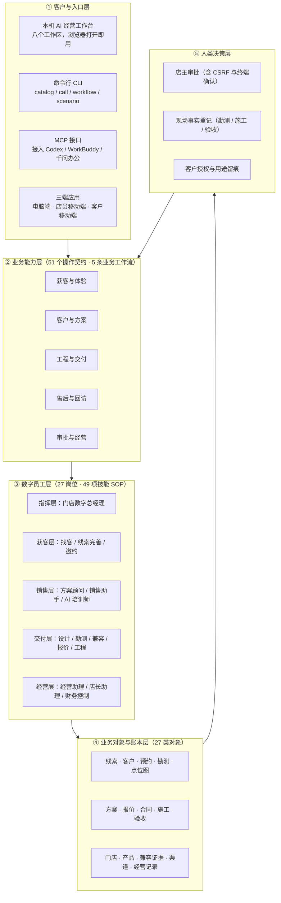
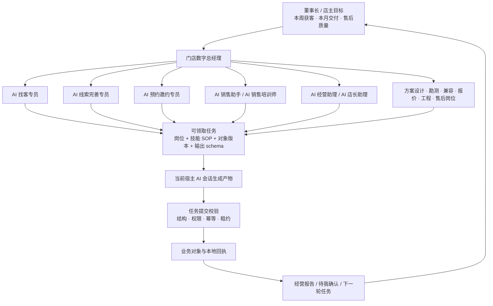
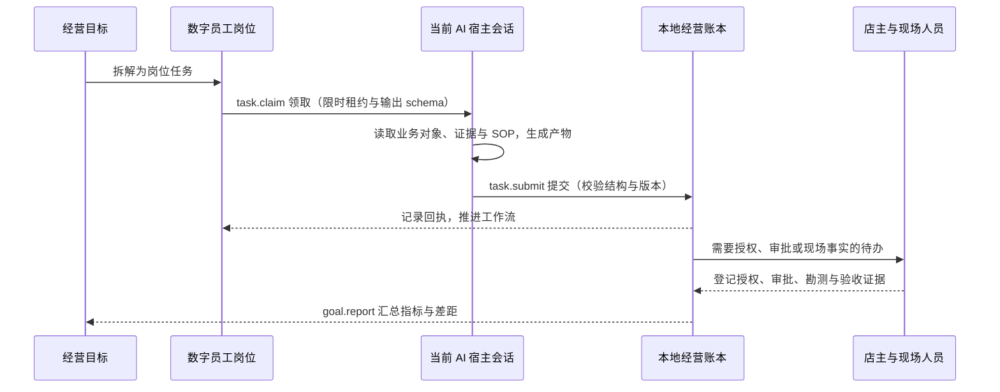
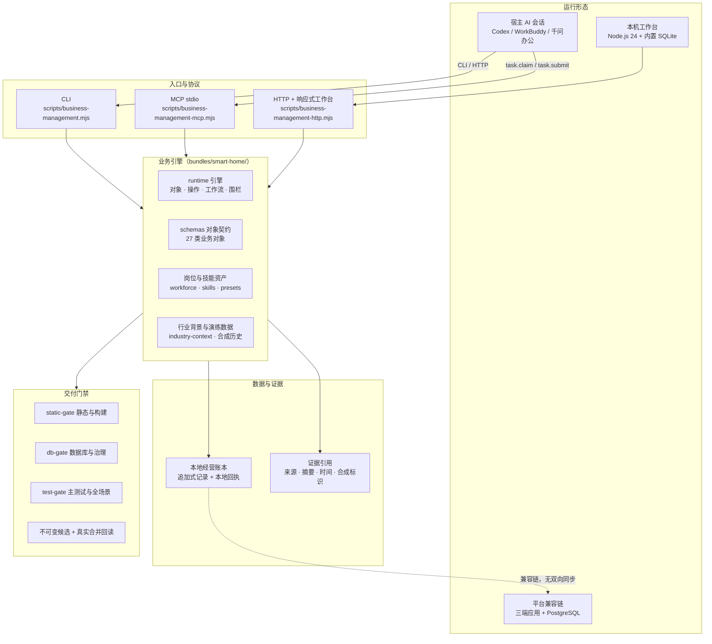
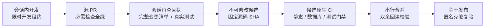

# BusinessManagementSystem · AI 自主经营系统｜全屋智能门店

**一家全屋智能门店真正需要的，不是再多一张表格，而是一条从第一条线索到客户交付都不会断的经营主线。**

客户买的是"住进去以后一直好用"：灯光、窗帘、安防、场景和售后响应。门店最容易丢的恰恰是交接：设计师转来一句"王先生，成都南边某楼盘，想看看智能灯光"，顾问手里没有姓名、电话和预算；展厅聊过的需求没落到方案里；点位图、施工变更和验收结果散在聊天记录、表格与文件之间；店长想知道"这周该跟哪几条线索、哪些单子卡在哪一步"，却没有一张可信清单。

本系统把 **获客 → 到店体验 → 现场勘测 → 方案设计 → 报价 → 施工 → 调试 → 验收 → 售后** 放进同一套可追溯的经营账本，让 27 个岗位、49 项技能 SOP 的数字员工围绕门店目标干活；价格承诺、客户授权、现场结果这类不能由机器拍板的事，永远留给人。

源码：[CNB 公共仓库](https://cnb.cool/workloom-ai/workloom-BusinessManagementSystem) · 许可证：[Apache-2.0](LICENSE) · 工程基座：WorkLoom 平台行业包架构 · 运行要求：Node.js ≥ 24

---

## 这套系统为谁而做

| 如果你是 | 你会用它做什么 |
| --- | --- |
| 门店老板 / 店长 | 每天早上看到"今天该跟的线索、待审批的报价、缺证据的工程、有风险的售后"，把目标拆给人和 AI，晚上核对结果 |
| 销售顾问 / 方案设计师 | 拿到完整的客户档案与勘测记录，让 AI 先备好话术、方案差异和异议答复，自己负责判断与承诺 |
| 交付 / 售后负责人 | 点位图、施工计划、调试记录、客户验收、售后工单按项目串起来，卡在哪一步一目了然 |
| 想换行业的技术团队 | 行业包（岗位、技能、对象、流程、行业背景）与引擎、工作台、交付机制分层，替换行业包即可复用整套能力 |

**现在还不适合用来做什么**：真实收款与付款、自动外呼或自动私信、直接控制客户家里的设备、代替人类签字与验收。这些连接器当前为 `disabled`，系统只把它们记录为待办。

## 用了它，门店的一天有什么不同

| 门店今天的样子 | 用系统之后 | 人负责什么 |
| --- | --- | --- |
| 线索散在微信、名片、异业伙伴的口头推荐里，只有一个姓氏 | 线索从哪个渠道来、目前已知什么、还缺什么，一眼可见；AI 给出下一步该问的问题 | 核对客户用途授权，决定是否继续跟进 |
| 客户到店看中一套方案，但需求没落到纸面 | 体验路线、需求摘要、方案差异、异议答复由 AI 备妥，直接进入方案与报价 | 价格、折扣、工期、兼容性等承诺由人确认 |
| 点位图、施工变更、验收照片分散在多个群和文件里 | 每个项目一条主线：勘测 → 点位 → 设计 → 报价 → 施工 → 调试 → 验收 → 售后，每一步都能追溯到来源 | 现场勘测、安装、调试、验收的"事实"由现场人员登记 |
| 老板想知道经营状况，只能等周会 | 经营总览与经营报告按本地账本实时生成：线索漏斗、待审批、待现场证据、售后风险 | 定目标、给资源、处理待决事项 |

## 产品架构



产品分五层，每层只做自己该做的事：入口层负责"怎么用"，业务能力层负责"做什么"，数字员工层负责"谁来做"，数据层负责"凭什么相信"，人类决策层负责"谁拍板"。

## 一条线索如何走到交付


| 环节 | 系统产出 | 必须由人提供 |
| --- | --- | --- |
| 线索进入 | 渠道、称呼、已知引用与来源；未知字段保持未知 | 线索真实来源与用途授权 |
| 线索完善 | 应问问题清单、补充提议（草案状态，需确认后才成为客户事实） | 客户确认的信息 |
| 到店体验 | 需求摘要、路线建议、销售话术、陪练记录 | 邀约确认、现场判断 |
| 勘测与点位 | 结构化勘测记录、毫米坐标点位图与修订版本 | 真实测量数据 |
| 方案与报价 | 分房间场景设计、设备清单、兼容证据、毛利复算 | 价格与承诺审批 |
| 施工与调试 | 施工计划、采购到货核对、逐场景调试记录 | 现场施工与测试结果 |
| 验收与售后 | 验收清单、培训与账号移交记录、售后工单闭环 | 客户签字与真实处置 |

## 数字员工与 Agent 怎么协作



任务闭环的每一步都留下痕迹，并且调度器自身**不调用模型**——持续 AI 工作依赖一个正在运行的宿主会话：



## 技术架构



几个关键工程选择，客户不需要理解实现，但值得知道它们带来的保障：

- **一本账，三种入口**：CLI、MCP 和浏览器工作台读写同一份数据；关闭浏览器或宿主会话后记录仍然保留。
- **追加式记录**：关键业务记录与回执只增不改，事件链可校验，避免"改一行数字就换了结论"。
- **围栏先行**：涉及客户隐私、承诺边界、资金与设备安全的动作在引擎层被拦截，界面与接口无法绕过。
- **宿主模型而非内置通道**：模型由你正在使用的 AI 客户端提供，系统不另外保存模型密钥，也不在后台偷偷调用付费模型。

## 五分钟启动

要求：**Node.js 24 或更高版本**；本机工作台不需要先安装平台依赖。

```bash
git clone https://cnb.cool/workloom-ai/workloom-BusinessManagementSystem.git
cd workloom-BusinessManagementSystem

node scripts/business-management.mjs doctor        # 自检：环境、数据范围、入口
node scripts/business-management.mjs setup --client all   # 生成 Codex / WorkBuddy / 千问办公 / 通用 MCP 配置
node scripts/business-management.mjs init --demo   # 导入成都模拟门店的完整演练数据
node scripts/business-management.mjs serve         # 启动工作台
```

浏览器打开 **http://127.0.0.1:9393**，八个工作区分别是：

| 工作区 | 你会看到 |
| --- | --- |
| 经营总览 | 门店目标、经营指标、风险与待办 |
| 获客与体验 | 线索、渠道、到店体验与邀约 |
| 方案与交付 | 勘测、点位图、设计方案、报价、施工、验收 |
| 售后与回访 | 工单、处置进度、客户回访 |
| 待我确认 | 需要店主审批或人类登记的事项 |
| 数字员工 | 27 个岗位、技能归属与可领取任务 |
| 门店与产品 | 门店资料、产品与兼容证据、行业背景 |
| 业务记录 | 全部业务对象的明细与来源 |

演练数据是**明确合成的虚构门店**（"蜀光智家 · 成都高新体验店"），包含 261 条业务记录、53 个业务流实例、49 个可领取的岗位任务。重复执行 `init --demo` 会恢复同一份数据集，不会把模拟历史说成刚完成的 AI 成果。

## 让 AI 真正开始干活

在工作台所在的 AI 会话里给出这样一条任务即可：

> 使用本仓 business-management 技能，读取成都模拟门店的经营目标、未完善线索和可领取任务。优先准备线索完善、到店邀约、销售与店长经营待办；按每次 claim 的岗位规程和 outputSchema 生成并提交产物。缺字段就说明缺口，不猜客户陈述。遇到人审或现场证据保留待办，并区分模拟历史与本次真实宿主执行。

系统会把任务拆到具体岗位（例如"AI 线索完善专员"），附带该岗位的技能 SOP、业务对象版本和输出 schema；模型产出经校验后写入账本，需要店主决策或现场事实的部分变成"待我确认"。

## 从演练走到你的真实门店

先在演练数据上走完三条主线——残缺线索完善、方案与工程交接、店长复盘——确认每一步的来源、状态与未闭事项，再为自己的门店建立独立的 live 数据目录：

```bash
node scripts/business-management.mjs init --mode live --data-dir /absolute/path/bms-live --tenant my-store --workspace operations
node scripts/business-management.mjs setup --client codex --mode live --data-dir /absolute/path/bms-live --tenant my-store --workspace operations
```

真实数据模式禁止合成历史与合成证据。原始电话、微信、家庭地址与账号密码不进入公开仓库、模型报告或普通业务对象；联系方式以受控引用保存，客户授权、勘测、签约与验收证据由人登记。

## 安全、合规与能力边界

- **模拟与真实分界清楚**：演练数据带合成标识；`externalVerified=false` 表示"只在本地记录成立"。
- **人类在环**：审批需要店主在真实终端确认，接口无法从业务参数取得店主身份；报价、合同、承诺必须人工确认。
- **最小采集**：联系方式以引用存储，客户资料按用途授权，未授权不用于触达与导出。
- **不夸大结果**：训练记录不等于成交，发布准备包不等于已外发，施工计划不等于已施工，售后记录需真实服务与客户确认才能闭环。
- **可复现的证据链**：关键结论附带来源、时间、摘要与版本；每条记录都能追溯是谁、在什么依据下写入的。

## 仓库地图

| 目录 | 作用 |
| --- | --- |
| `scripts/business-management*.mjs` | 本机工作台：CLI、HTTP 服务、MCP、客户端配置 |
| `bundles/smart-home/runtime/` | 业务引擎：对象、操作、工作流、围栏与调度 |
| `bundles/smart-home/schemas/` | 27 类业务对象的字段契约 |
| `bundles/smart-home/library/` | 岗位目录、技能目录、行业背景与官方公开参考 |
| `bundles/smart-home/skills/` | 49 项岗位技能 SOP |
| `bundles/smart-home/ui/workbench/` | 响应式 AI 经营工作台 |
| `apps/site/` | 对外产品介绍页（中英双语） |
| `scripts/delivery/` | 交付机制：审查回执、不可变候选、真实合并回读 |
| `docs/` | 用户指南、业务矩阵、验收报告与工程规范 |

## 资料与验证入口

- [用户功能清单](docs/03-功能清单-用户版.md)：每项工作给门店带来什么，还需要人做什么。
- [全屋智能落地向导](docs/04-行业落地向导-用户版.md)：门店、产品、场景、渠道、人员与证据如何配置。
- [店长使用指南](docs/01-门店店长使用指南.md) 与 [新客户首次接入流程](docs/02-新客户首次接入完整流程.md)：按真实日常操作走一遍。
- [门店实战手册](docs/SMART-HOME-STORE-PLAYBOOK.md)：三条主线的完整操作路径。
- [AI 工作台接入](docs/AI-WORKBENCH.md)：命令、数据范围、宿主任务循环、审批与恢复。
- [业务与实现矩阵](docs/SMART-HOME-BUSINESS-MATRIX.md)：对象、操作、岗位、异常路径与证据等级。
- [本轮实战深化验收](docs/SMART-HOME-DEPTH-ACCEPTANCE.md)：架构取舍、渐进资料链、真实宿主任务与生产边界。

工程侧验证入口：

```bash
pnpm test:business        # 全屋智能业务回归（含权限、幂等、租约、回执与治理）
pnpm product:verify       # 产品身份、行业包与交付边界
pnpm capabilities:check   # 能力导览与 README 自动区块一致性
pnpm typecheck            # 全仓类型检查
pnpm test                 # 平台主测试套件
```

<!-- CAPABILITIES:BEGIN -->
<!-- 本区块由 scripts/generate-capabilities.mjs 自动生成（2026-10-09），请勿手改；重跑 pnpm capabilities 更新 -->

## 🧩 系统能力速览（自动生成 · 与代码同步）

> 以下为源码目录与入口清单；实际调用及结果状态见能力导览的独立证据字段，未验证项不能作交付承诺。

- 🏠 **全屋智能门店经营（默认入口）**：响应式 AI 经营工作台 · 业务操作契约 ×51 · 宿主模型工作流 ×5 · 数字岗位 ×27 · 行业技能 SOP ×49 · 克隆后工作台配置 · 成都门店经营演练 · 全屋智能行业背景

继承平台、历史行业与演示资产列在完整能力导览的工程目录中；默认经营入口、门店资料与 AI 岗位使用全屋智能行业包。

> 📖 完整能力导览：[docs/capabilities.auto.md](docs/capabilities.auto.md) ｜ 🤖 AI Agent 入口：[AGENTS.repo.md](AGENTS.repo.md) ｜ 🎯 首启：`pnpm setup --client all` → `pnpm bm init --demo` → `pnpm dev`
<!-- CAPABILITIES:END -->

## 给开发者

当前产品默认只启用 `smart-home` 行业包；继承的平台工程能力保留在独立兼容链中，SQLite 经营账与平台数据库之间没有双向同步。平台开发路径为 `pnpm install --frozen-lockfile`、`pnpm setup:foundation`、`pnpm dev:foundation`。

每一次改动进入主干都要经过同一套交付链路，客户看到的稳定版本就是这条链路的结果：



推荐阅读顺序：[AGENTS.md](AGENTS.md) → [AGENTS.repo.md](AGENTS.repo.md) → [业务与实现矩阵](docs/SMART-HOME-BUSINESS-MATRIX.md) → [交付机制说明](scripts/delivery/README.md) → [开发协议](docs/DEVELOPMENT-PROTOCOL.md)。目录清单、实际调用与结果验证分别取证，不互相替代。
