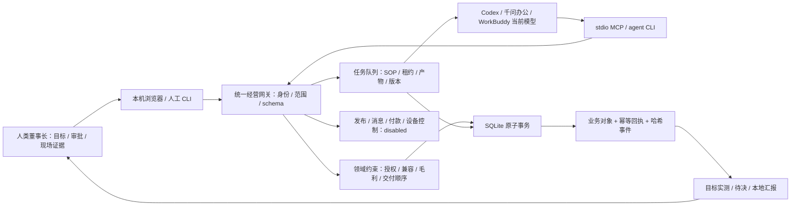

# 全屋智能门店经营业务与四层实现矩阵

## 覆盖率声明

- 范围内文件总数：242；精读：173；机检/脚本解析：69；抽样：0；未读：0。
- 范围是本行业代理的显式清单：上游只读对照62文件，当前输出仓180文件；没有把整个继承仓库纳入精读口径。
- 未精读清单、选段范围与理由见 [industry-read-coverage.json](evidence/industry-read-coverage.json) 的 files/scopeCuts。源Hotel行业60文件中57精读、3机检与选段核对；当前20份preset、35份SOP和7份runtime核心实现完整阅读。机器覆盖不能表示理解度。
- 后续 PostgreSQL 兼容修复另有109文件的明确范围：43精读、66机检/解析、抽样0、未读0，见 [industry-compat-read-coverage.json](evidence/industry-compat-read-coverage.json)。其中43份迁移执行与机器索引为B，广域路由/历史套件只读取关联范围也为B。两个清单与同伴清单存在重叠，交付总数必须按来源、路径和当前SHA去重，不能直接相加。

本文使用 A＝完整代码/规程阅读、B＝全量解析和实测结果汇总、C＝抽样、D＝设计假设或未验证。文件数量是阅读方式记录，不能代表理解度或生产验收通过率。来源清单中的网页正文与搜索索引另列，不能替代源码证据。

## 产品与使用者

**[A]** 本产品的默认行业包是 `smart-home`，面向全屋智能门店老板、门店顾问、方案/工程/售后人员。经营入口以客户线索、现场证据、方案、报价和交付为中心，当前 AI 工作台模型通过 CLI/MCP 领取业务任务，确定性运行时校验并保存结构化产物。依据：[产品清单](../product.manifest.json)、[运行时网关](../bundles/smart-home/runtime/index.mjs) `createBusinessEngine`。

**[D]** 试点假设为独立门店或少量门店、既有设备销售与安装团队、老板可以核实报价和现场材料。用它解决三种损失：来源不清的线索交接、未核实设备条件却提前报价、交付与售后缺记录导致反复追问。价值判据是同一业务输入能找到负责人、前置条件、产物和未闭事项；本文不采用节省工时、增收比例或成交保证作为已实现指标。

**[A]** 默认独立入口使用本机 SQLite 与当前宿主模型，无额外模型 API 调用；继承的 WorkLoom 平台、PostgreSQL、三端客户端与桌面发行仍各有运行链。它们共用行业资产，但 native 的 task/approval/local.sqlite.commit 不是旧平台的线程、tRPC 审批和数据库事件。依据：[AI工作台接入](AI-WORKBENCH.md)、运行时 `catalog`、[存储](../bundles/smart-home/runtime/storage.mjs) `BusinessStorage.transaction`。

## 需求、假设与候选方案

| 类别 | 要求 | 当前实现或验证边界 | 证据 |
| --- | --- | --- | --- |
| 功能 | 获客归因、资格、授权、内容草稿、体验计划 | 固定获客工作流，客户确认与外发分别保存状态 | A：`BusinessWorkflows.applyArtifact` |
| 功能 | 勘测、BOM、场景、兼容、报价、人审 | 双SKU精确版本、网络/电气校验，整数分计算，审批绑定digest | A：`BusinessDomain.buildSolution/createQuote/decideApproval` |
| 功能 | 采购、安装、调试、验收、售后 | 顺序依赖和人类证据，采购记录不代表支付 | A：`recordProcurement/recordCommissioning/recordAcceptance` |
| 功能 | 老板目标、总经理拆解、岗位任务、汇报与纠偏 | 管理动作排入employee-work；人类可暂停/恢复目标 | A：`BusinessWorkflows.start/applyArtifact`、`goal.instruct` |
| 接入 | 当前宿主模型、CLI、MCP、本机浏览器 | 三种入口共享网关，MCP固定agent，生成项目配置 | A：接入文档、HTTP边界；B：宿主进程证据 |
| 一致性 | 写入可重放、并发冲突明确、失败回滚 | `BEGIN IMMEDIATE`，幂等键、旧store/SKU expectedVersion、事务原子提交 | A：存储实现；B：并发测试结果 |
| 规模 | 初期少量门店、同机低并发写入 | 本地同步SQLite；对象list分页上限500，snapshot默认每类100 | A：schema/存储；D：试点规模假设 |
| 延迟 | 操作错误及时可见，宿主超时可恢复 | DB忙等待5秒、HTTP请求15秒、租约30–3600秒；实际大数据p95未测 | A：存储/HTTP/schema；D：性能未验证 |
| 数据量 | 不把分页结果误当全量经营账 | 业务聚合使用当前范围全部对象；每次交易完整校验账本，长账性能待测 | A：`goalReport`、`verify`；D：长期性能 |
| 隐私 | 不在经营对象保存明文联系信息或账号密钥 | opaque contactRef、模式检测、禁止敏感字段；用户文档仍视为数据 | A：`rejectSecretsAndPII`，不是完整DLP认证 |
| 责任 | 报价承诺、授权和现场签收由人类承担 | 真实TTY确认，浏览器owner会话和CSRF；MCP不能提权 | A：HTTP/Common、domain.human |
| 外部事实 | 本地写入与实际平台/设备结果分别表述 | externalVerified=false；发布/消息/付款/设备控制disabled | A：网关/domain；B：结果证据 |

| 候选方案 | 优点 | 成本、风险与前提 | 选择 |
| --- | --- | --- | --- |
| 直接沿用酒店LLM服务与线程调度，在业务prompt中换行业 | 可复用既有服务端线程、UI、审计和模型路由 | 宿主内置模型不等于旧LLM_PROVIDER；酒店领域对象和线程成功不能证明BOM/报价/现场交付；需要新的模型连接或付费API | D：不采用为默认经营执行链 |
| 独立行业确定性适配器 + 宿主CLI/MCP + 复用行业包与三端入口 | 当前模型直接执行任务，无新增模型密钥；领域校验、审批与本地回执有专门契约；外部动作默认关闭 | 两种账本口径须显式区分；本机owner信任边界由OS/TTY承担；大数据/远程协作/真实平台连接器另需实现 | D：选定，A：已实现此运行链 |

选定第二种方案，是因为用户要求当前工作台内置模型参与实际业务步骤，又要求不伪造客户、兼容性或外部执行。独立运行时把模型产物与确定性业务约束分开，继承平台保留为资产、三端与治理兼容层。

## 第一层：用户旅程与核心流程

| 具体场景 | 前置记录 | 用户与数字员工的动作 | 成功定义 | 缺失/拒绝路径 | 证据 |
| --- | --- | --- | --- | --- | --- |
| 线上咨询准备到店体验 | 门店、线索、明确用途授权；客户已陈述的预算/装修阶段 | 接待员核对资格；选题员产草稿；顾问产拟议体验；总经理汇报 | 本地qualified线索、proposed体验、草稿与报告可读回；不等同到店/成交 | 信息缺失或fit=false时跳过内容/体验并报告；没有appointment授权拒绝 | A：growth-acquisition |
| 装修中客户申请全屋方案 | 人类勘测、厂家SKU/安装约束、精确版本兼容证据 | 设计师产BOM/场景；报价员产成本/售价/折扣草案；店主审digest | 方案validated-local、报价awaiting-approval；通过后准备交付计划 | 零线、负载、网络、兼容缺依据阻断；财务红线不得人审覆盖 | A：project-delivery、buildSolution |
| 合同项目进场验收 | 批准且未过期报价、合同、完整BOM到货 | 人类登记安装安全项、逐场景调试、客户培训和凭据交接 | 项目accepted-local-record且零未闭问题；外部事实仍需人工核实 | 缺采购不能装；漏场景/失败不能验；客户不接受或缺培训保持pending | A：project/create与现场操作 |
| 已交付项目设备离线 | 项目、售后工单、用途/责任边界 | 售后员分级与处置计划；专业人员现场服务；客户确认与未来回访 | 本地resolved、服务证据和回访计划齐备 | 安全/隐私必须人类专业升级；禁止带电拆箱或绕过安全系统 | A：aftercare-loop |
| 老板要求本月改善经营 | 门店、可计量目标、现存业务对象 | 总经理核对实测指标、分配岗位技能；宿主领取准备任务；老板改目标或暂停 | 管理诊断值与实时指标相等；岗位任务实际入队；报告含差距与待决 | 子目标缺lead/survey/ticket为waiting-input；外部预算/发布授权不自动获得 | A：management-loop |

**[A]** 五种业务指标分别为 qualified-leads、experience-plans、accepted-projects、resolved-aftercare、management-reports。前四种按当前工作区目标门店累计记录计数；management-reports按该goal计数。deadline控制执行期限，当前报告没有按日期窗口筛选，也没有真实营收、转化率、退款或账款指标。pendingApprovals覆盖当前工作区，不能解释成仅目标门店待办。依据：`BusinessDomain.goalReport`。

## 第二层：能力、数据模型与接口

### 19类逻辑对象

**[A]** 每个对象共有 id/type/tenantId/workspaceId/dataMode/version/createdAt/updatedAt。金额用非负安全整数分；真实数据和sandbox不能在同一tenant/workspace切换口径。对象关系通过当前范围读取与业务校验维护，物理库没有为每个逻辑类型单独建表。

| 类型 | 核心字段/引用 | 版本、状态与校验 |
| --- | --- | --- |
| store | name/city/serviceAreas/minMarginRatio/maxDiscountRatio | 旧记录必须expectedVersion，阈值只可收紧；变更阈值需人类 |
| sku | manufacturer/model/category/protocol/firmwareVersion/costCents/priceCents/evidence/installationRequirements | live安装参数必填；inactive不能进方案；价格不得低于记录成本 |
| compatibility | leftSkuId/rightSkuId/result/conditions/evidence/expiresAt/skuVersions/firmwareVersions | 精确版本与期限，当前incompatible证据优先阻断 |
| lead | storeId/alias/contactRef/channel/campaignRef/intent/budgetCents/renovationStage/consent | first-recorded-touch归因；授权按purpose；资格状态可为needs-information |
| experience | leadId/startsAt/durationMinutes/scenes/confirmationEvidence | proposed与customer-confirmed分开；外部通知未启用 |
| survey | leadId/rooms[].circuits/network/hazards/evidence | 人类现场记录；房间/房内回路ID唯一 |
| solution | surveyId/bom/scenes/compatibilityIds/exclusions/skuSnapshots/costCents | 方案validated-local，physicalFeasibilityVerified=false |
| quote | solutionId/劳动成本与售价/discountCents/validUntil/terms/commitmentDigest | 毛利/折扣policyViolations；draft→awaiting-approval→approved/rejected |
| approval | targetType/targetId/contentDigest/reason/expiresAt/summary/decision | pending/approved/rejected/expired；7天上限；人类身份与摘要 |
| project | quoteId/solutionId/leadId/storeId/contractEvidence/dueAt/milestone | contract→procurement→installation→commissioning→acceptance |
| procurement | projectId/items[].skuId/quantity/serialRefs/evidence | 累计数量不超BOM；序列引用不重复；不代表下单/支付 |
| commissioning | projectId/results[].sceneId/passed/observation/evidence | 全场景一次一条结果；任一失败不推进验收 |
| acceptance | projectId/customerAccepted/trainingDelivered/credentialsTransferred/outstandingIssues/evidence | 四项条件共同决定acceptedLocally；externallyVerified=false |
| aftercare | projectId/category/severity/description/dueAt/triage/resolutionPlan/evidence/followupAt | 安全/隐私high或critical；人类服务与客户确认后resolved |
| content | storeId/channel/title/body/claims/skuIds/piiFree/approvalId | draft→awaiting-approval→approved-pending-connector；绝对承诺拒绝 |
| goal | storeId/title/metric/target/deadline/constraints/status/lastInstruction | active/paused/waiting-input；外部执行权未授予 |
| workflow | kind/goalId/storeId/refs/taskIds/phaseIndex/waitingFor/employeeId/skillId/objectRefs | running/waiting-approval/waiting-evidence/completed/failed；同输入去重 |
| task | workflowId/employee/skill/skillAsset/outputSchema/status/attempts/lease*/artifact/modelTrace/failureHistory | ready/leased/completed/failed/cancelled；任务实体存租约hash，完整领取响应留在幂等缓存；完整SOP随领取提供 |
| report | kind/goalId/workflowId/summary/risks/nextActions/measuredMetrics/evidence | 业务决策包或employee-work准备报告；不伪装成外部/物理/付款/视频执行 |

### SQLite物理表与索引

| 表 | 字段 | 主键/索引/约束 |
| --- | --- | --- |
| scope_registry | tenant, workspace, data_mode | PK(tenant,workspace)，首次口径后不可复用为另一dataMode |
| entities | tenant, workspace, type, id, version, doc | PK(tenant,workspace,type,id)，version>0，FK范围表；STRICT |
| business_events | seq, tenant, workspace, event_id, payload, hash, prev_hash, created_at | seq主键，event_id UNIQUE，events_scope(tenant,workspace,seq)，禁止UPDATE/DELETE触发器 |
| idempotency | tenant, workspace, key, request_hash, result, event_id | PK(tenant,workspace,key)，FK事件，禁止UPDATE/DELETE触发器 |

**[A]** 存储启用WAL、synchronous=FULL、trusted_schema=OFF和5秒busy timeout。业务写入在BEGIN IMMEDIATE中检查账本、执行领域操作、更新投影、附加事件、附加回执再COMMIT；失败ROLLBACK。同幂等键同请求/同actor读回旧结果，不同内容或actor返回IDEMPOTENCY_CONFLICT。SHA-256链加投影/回执交叉校验能发现本地损坏，不能抵御拥有OS管理员权限的人同时重写整个数据库，也没有外部不可抵赖锚。

**[A]** `task` 实体保存 `leaseTokenHash`；不可变 `idempotency.result` 保存完整领取响应，包含原始明文 `leaseToken` 和当时的任务上下文，用于同请求、同actor/渠道重放。缓存没有单独加密，旧租约过期或完成后仍可能在数据库和备份中保留。`entity.get/list`、`state.snapshot`、`task.list`、`workflow.get` 移除任务租约hash；`ledger.list` 返回事件中的请求/结果/实体摘要，不返回完整幂等响应或原始token。重放旧响应不续期，`task.submit/fail` 仍校验当前状态、操作者、token hash与期限。依据：`BusinessStorage.transaction/events`、`BusinessDomain.safe/read`、`BusinessWorkflows.claim/lease`；**[B]** [隔离存储与读取实测](evidence/lease-storage-boundary.json) 23项通过且没有记录token值。这是并发契约和本机敏感数据边界，不能解释为独立身份认证或token从未明文落盘。

### 39项业务操作

**[B]** 下表必填字段由当前 `OPERATION_CATALOGUE` 导出；完整类型、长度、枚举和嵌套schema见 [native-operations.json](../bundles/smart-home/library/native-operations.json)。**[A]** 结果描述按 `BusinessDomain.execute` 与 `BusinessWorkflows.execute/applyArtifact` 精读核对。所有写操作均需 idempotencyKey；risk=review表示审计风险分类，实际人类门禁由对应方法检查，不能认为所有review操作都由同一个审批对象解锁。

| 操作 | 权限风险 | 必填字段 | 结果与边界 |
| --- | --- | --- | --- |
| `status` | 只读 | 无 | 运行口径、连接器状态、对象计数与账本校验 |
| `catalog` | 只读 | 无 | 39项操作、5类工作流、岗位技能归属与输入schema |
| `entity.list` | 只读 | `type` | 当前工作区该类型的分页对象；拒绝未知类型 |
| `entity.get` | 只读 | `type`, `id` | 当前工作区指定对象；不存在返回NOT_FOUND |
| `state.snapshot` | 只读 | 无 | 19类对象的total与items；单类上限500 |
| `ledger.verify` | 只读 | 无 | 事件、投影、幂等回执的交叉校验与issues |
| `ledger.list` | 只读 | 无 | 当前工作区事件序号、载荷与hash |
| `approval.list` | 只读 | 无 | 审批有效状态与摘要；到期状态动态计算 |
| `task.list` | 只读 | 无 | 任务状态、岗位、技能、产物与失败历史；隐藏租约hash |
| `workflow.get` | 只读 | `workflowId` | 流程状态、关联对象、任务、waitingFor和跳过阶段 |
| `goal.report` | 只读 | `goalId` | 本门店累计本地指标、目标差距和当前工作区待审批项 |
| `store.upsert` | auto | `id`, `name`, `city`, `serviceAreas`, `minMarginRatio`, `maxDiscountRatio`, `idempotencyKey` | 门店规则；旧记录必须expectedVersion，财务红线只可收紧 |
| `sku.upsert` | auto | `id`, `manufacturer`, `model`, `category`, `protocol`, `firmwareVersion`, `costCents`, `priceCents`, `evidence`, `idempotencyKey` | 设备版本、价格成本、证据与安装约束；live禁止猜电气参数 |
| `compatibility.record` | auto | `id`, `leftSkuId`, `rightSkuId`, `result`, `conditions`, `evidence`, `expiresAt`, `idempotencyKey` | 精确双SKU版本、固件、兼容结果、条件与期限 |
| `lead.create` | auto | `id`, `storeId`, `alias`, `contactRef`, `channel`, `intent`, `consent`, `idempotencyKey` | 线索、首记触点归因与用途授权；live授予授权需要人类 |
| `lead.authorize` | auto | `leadId`, `status`, `purposes`, `evidence`, `idempotencyKey` | 用途授予/撤回独立留痕；live需要人类确认 |
| `experience.schedule` | auto | `id`, `leadId`, `startsAt`, `durationMinutes`, `scenes`, `idempotencyKey` | 拟议体验计划；customer-confirmed须客户证据和人类 |
| `survey.record` | review | `id`, `leadId`, `renovationStage`, `rooms`, `network`, `hazards`, `evidence`, `idempotencyKey` | 现场勘测记录；房间/回路ID唯一且需要人类证据 |
| `solution.build` | auto | `id`, `surveyId`, `name`, `bom`, `scenes`, `compatibilityIds`, `idempotencyKey` | BOM、场景、精确兼容/电气/网络校验与SKU快照 |
| `quote.create` | auto | `id`, `solutionId`, `laborCostCents`, `laborPriceCents`, `discountCents`, `validUntil`, `terms`, `idempotencyKey` | 整数分复算、毛利/折扣诊断与承诺digest；未形成外部承诺 |
| `quote.request_approval` | review | `quoteId`, `expiresAt`, `reason`, `idempotencyKey` | 待审批快照；期限不超过报价且最多7天 |
| `approval.decide` | review | `approvalId`, `decision`, `reason`, `contentDigest`, `idempotencyKey` | 人类按digest批准或拒绝；红线违规不能override |
| `project.create` | review | `id`, `quoteId`, `contractEvidence`, `dueAt`, `idempotencyKey` | 已批准报价、签约证据、当前方案形成项目 |
| `procurement.record` | review | `id`, `projectId`, `items`, `evidence`, `idempotencyKey` | 累计到货数量与序列引用；超BOM/重复serial拒绝 |
| `project.milestone` | review | `projectId`, `milestone`, `evidence`, `professionalRef`, `safetyChecklist`, `idempotencyKey` | 采购完整后的安装记录；安全项须全true |
| `commissioning.record` | review | `id`, `projectId`, `results`, `evidence`, `idempotencyKey` | 全部场景逐项测试；失败回到installation |
| `acceptance.record` | review | `id`, `projectId`, `customerAccepted`, `trainingDelivered`, `credentialsTransferred`, `outstandingIssues`, `evidence`, `idempotencyKey` | 客户接受/培训/凭据交接/零未闭问题共同判定 |
| `aftercare.open` | auto | `id`, `projectId`, `category`, `severity`, `description`, `dueAt`, `idempotencyKey` | 工单、等级和门店归属；安全/隐私须high或critical |
| `aftercare.resolve` | review | `ticketId`, `resolution`, `evidence`, `customerConfirmed`, `followupAt`, `idempotencyKey` | 人类服务证据、客户确认和未来回访时间 |
| `content.create` | auto | `id`, `storeId`, `channel`, `title`, `body`, `claims`, `skuIds`, `piiFree`, `idempotencyKey` | 本地草稿、声明证据、去PII声明；拒绝绝对兼容/安全承诺 |
| `content.request_publication` | review | `contentId`, `expiresAt`, `reason`, `idempotencyKey` | 内容审批快照；连接器仍disabled |
| `content.publish` | block | `contentId`, `approvalId`, `idempotencyKey` | 始终拒绝CONNECTOR_DISABLED；不产生外部发布回执 |
| `goal.create` | auto | `id`, `storeId`, `title`, `metric`, `target`, `deadline`, `constraints`, `idempotencyKey` | 可计量目标、约束、期限；授权仅local-planning-only |
| `goal.instruct` | review | `goalId`, `instruction`, `action`, `idempotencyKey` | 人类调整目标、暂停/恢复与指令历史 |
| `workflow.start` | auto | `id`, `kind`, `goalId`, `idempotencyKey` | 固定业务流程或指定岗位技能准备流程；同输入去重 |
| `workflow.tick` | auto | `idempotencyKey` | 确定性推进、期限/租约恢复；modelCalls=0 |
| `task.claim` | auto | `idempotencyKey` | 岗位规程、上下文、outputSchema与一次性租约 |
| `task.submit` | auto | `taskId`, `leaseToken`, `artifact`, `modelTrace`, `idempotencyKey` | schema/租约/对象版本校验、产物应用、依赖推进与回执 |
| `task.fail` | auto | `taskId`, `leaseToken`, `error`, `retryable`, `idempotencyKey` | 有限重试或终态失败，保留failureHistory |

### 三种调用通道与HTTP契约

**[A]** Node API：`createBusinessEngine({dataDir,tenantId,workspaceId,dataMode})` 返回 `catalog()/call(operation,input,actor)/close()`。通道层验证actor，业务输入不得自选身份。CLI：`node scripts/business-management.mjs describe <operation>` 读取schema；`call <operation> --input-file <path>`固定agent；人工审批和现场登记走真实TTY的 `approve` / `human-call`。完整命令与配置见 [AI-WORKBENCH.md](AI-WORKBENCH.md)。

**[A]** 本机HTTP默认127.0.0.1:9393，仅允许当前localhost/127.0.0.1 Host、同源Origin，拒绝跨站请求和查询参数；状态API不提供远程身份系统。JSON请求需application/json，传输限1MiB，业务输入限1,000,000字节。错误统一 `{error:{code,message}}`，消息截断与秘密脱敏。

| 方法/路径 | 参数 | 返回/失败 |
| --- | --- | --- |
| GET /api/catalog | 无 | 裸catalog对象，包含operations/workflows/workforce/externalConnectors |
| GET /api/state | 无 | `{operation:'state.snapshot',data:{type:{total,items}}}` |
| GET /api/status | 无 | `{operation:'status',data:{scope,counts,ledger,connectors}}` |
| POST /api/call | `{operation,input}` | agent调用结果；成功写返回receipt/replayed |
| POST /api/owner/session | `{}`，同源Origin，真实TTY服务 | 202 `{status:'pending',requestId}`与HttpOnly/Strict cookie；无TTY拒绝 |
| GET /api/owner/session | 会话cookie | anonymous/pending/authorized；已授权返回csrfToken与expiresAt |
| POST /api/owner/call | `{operation,input}`、cookie、X-BMS-CSRF、同源Origin | owner/humanConfirmed调用；申请5分钟、授权30分钟 |
| DELETE /api/owner/session | cookie；已授权时需X-BMS-CSRF | 清除会话与cookie |

**[A]** stdio MCP 工具名为 bms_ + 操作名点号替换为下划线，固定agent，过滤人类专属和block操作；tools、resources、prompts帮助宿主读取目录和任务。模型发生在宿主，不在tick/engine里。协议兼容与宿主配置不等于千问办公、WorkBuddy已真机验收；本次真实宿主证据是Codex，另外两种客户端仍未验证。

### 异常、并发与恢复路径

| 触发条件 | 错误/状态 | 恢复动作 | 证据 |
| --- | --- | --- | --- |
| 跨租户/工作区actor，MCP伪造owner | TENANT_SCOPE_MISMATCH / MCP_ACTOR_SPOOFING / PERMISSION_DENIED | 返回本工作区身份，禁止把输入当授权 | A：网关 |
| 旧门店/SKU缺版本或版本冲突 | VERSION_REQUIRED / VERSION_CONFLICT | 重新读取对象后人工判断再提交 | A：domain/storage |
| 同幂等键不同请求/actor | IDEMPOTENCY_CONFLICT | 保留原回执，新的业务意图使用新键 | A：storage |
| SQLite竞争写锁 | DATABASE_BUSY，503 | 使用相同幂等键有限重试；失败事务回滚 | A：storage |
| 账本、投影或回执摘要不一致 | LEDGER_INTEGRITY_FAILURE | 禁止写入/展示业务事实；核对备份与原始证据 | A：verify/网关 |
| 兼容过期、SKU变更、新冲突证据 | COMPATIBILITY_EXPIRED / STALE / CONFLICT / SOLUTION_SKU_STALE | 补精确厂家证据，重新建方案/报价 | A：buildSolution/assertSolutionCurrent |
| 电气/网络条件不满足 | NEUTRAL_WIRE_REQUIRED / CIRCUIT_OVERLOAD / VOLTAGE_REQUIREMENT_UNMET / NETWORK_REQUIREMENT_UNMET | 专业人员重新勘测或改BOM，禁止猜现场值 | A：buildSolution |
| 审批已过期、摘要不同或财务红线违规 | APPROVAL_EXPIRED / CONTENT_MISMATCH / QUOTE_POLICY_BLOCKED | 新方案与报价重新请求人审；阈值不可放宽 | A：decideApproval |
| 租约超时/被其他actor提交 | TASK_LEASE_EXPIRED / INVALID_TASK_LEASE | tick恢复，重新领取；有限次数耗尽则failed | A：lease/claim/tick |
| 岗位技能不归属、引用跨店或对象改变 | EMPLOYEE_SKILL_MISMATCH / STORE_SCOPE_MISMATCH / WORK_REFERENCE_STALE | 使用真实责任岗位和当前对象版本新建准备任务 | A：workforce/start |
| 模型artifact不合schema或编造指标 | INVALID_INPUT / METRIC_EVIDENCE_MISMATCH | 保留原状态，修正结构/来源后再提交 | A：submit/applyArtifact |
| 授权撤回、目标暂停/过期 | CONSENT_REQUIRED / GOAL_PAUSED / GOAL_EXPIRED | 人类核对用途/目标；到期取消ready/leased任务 | A：domain/workflows |
| 缺现场前置或安全项 | MILESTONE_ORDER / INSTALLATION_SAFETY_INCOMPLETE / INCOMPLETE_COMMISSIONING | 专业人员补有效证据，失败阶段不推进 | A：现场方法 |
| 尝试外部发布或API换URL | CONNECTOR_DISABLED / NOT_FOUND / FORBIDDEN_ORIGIN | 保持待外部执行；不能用批准模拟发布 | A：网关/HTTP |

## 第三层：数字员工、技能与编排

### 20岗位、35技能及唯一责任归属

**[A]** 20份preset与35份SKILL.md完整阅读后校对了owner、技能绑定、工具、write_back和岗位协议。运行时从 [workforce.json](../bundles/smart-home/library/workforce.json) 读取唯一归属，验证manifest声明与SHA-256，并检查每个SOP的name/owner/version/fence_bindings。claim包含封印后的完整SOP、技能digest和对象上下文。岗位目录不是自动执行外部平台动作的授权。

| 岗位 | 技能 | 责任 |
| --- | --- | --- |
| `store-ceo` / 门店数字总经理 | `store-diagnosis`, `goal-decomposition`, `owner-briefing` | 将董事长目标拆成获客、交付、售后任务；按证据向董事长汇报差距和待决事项。 |
| `growth-director` / 增长经营主管 | `campaign-review`, `partner-channel` | 经营渠道预算、伙伴合作和线索归因；核对有效线索与签约成本，生成调整建议。 |
| `market-researcher` / 本地市场研究员 | `market-intelligence`, `local-search-presence` | 读取有授权的本地需求、竞品公开信息和搜索证据；记录来源、时间与不确定性。 |
| `content-strategist` / 内容选题主理人 | `content-planning` | 将客户痛点、场景证据和门店服务范围变成分平台选题、脚本与搜索问答草稿。 |
| `video-producer` / 短视频制作员 | `short-video-production` | 编写可拍摄分镜、配音稿、字幕和剪辑说明；核对素材授权，标识模拟与真实实拍。 |
| `social-publisher` / 社媒发布管理员 | `social-publishing` | 整理发布审批和平台素材包；只有已配置连接器且真实回执成立才记录发布完成。 |
| `lead-concierge` / 客户线索接待员 | `lead-qualification`, `customer-consent` | 归集渠道意向、装修阶段、预算区间和服务地域；把用途授权与撤回独立留痕。 |
| `sales-consultant` / 门店方案顾问 | `consultative-sales`, `experience-appointment`, `referral-retention` | 按客户需求安排体验路线与勘测移交；不擅自给价格、兼容性和工期保证。 |
| `solution-designer` / 全屋智能方案设计师 | `solution-design`, `bom-check` | 基于现场勘测设计分房间点位、设备清单、一键场景和条件自动化；标明排除项。 |
| `survey-engineer` / 现场勘测工程师 | `site-survey`, `network-planning` | 接收合格现场人员勘测记录，核对回路、零线、负载、网络和安装约束；不代替现场测量。 |
| `compatibility-engineer` / 兼容性验证工程师 | `compatibility-verification`, `store-demo-health` | 核对设备型号、固件、网关、生态和功能集的精确兼容证据；未知组合保持待核验。 |
| `quote-controller` / 报价与合同审核员 | `quote-margin-control`, `contract-handoff` | 复算设备、施工、服务、折扣与毛利；发起报价承诺审批并对接签约证据。 |
| `project-manager` / 项目交付经理 | `project-scheduling` | 协调采购、进场、安装、调试、验收依赖和变更；缺前置证据不能推进工程里程碑。 |
| `procurement-controller` / 采购与库存管理员 | `procurement-inventory` | 核对批准清单、到货数量、型号版本和序列号；采购记录不等同支付或供应商下单。 |
| `installation-supervisor` / 安装质量主管 | `installation-quality` | 核对持证人员、断电保护、厂家指导、点位照片和装配结果；只记录现场证据。 |
| `commissioning-engineer` / 场景调试工程师 | `scene-commissioning` | 逐场景验触发、行为、失败回退、断网与手动控制；没有测试记录不声明调试成功。 |
| `acceptance-auditor` / 客户验收审核员 | `acceptance-handover` | 核对合同范围、每个场景、客户培训、账号交接与未闭问题；签收必须有客户证据。 |
| `aftercare-specialist` / 售后服务专员 | `aftercare-triage`, `aftercare-resolution`, `customer-followup` | 把离线、误触发、网络、设备、安全和隐私问题分流；按真实服务与客户确认闭环。 |
| `finance-controller` / 经营财务控制员 | `finance-reconcile` | 复核报价、合同、采购凭据、收款与应收差异；不收款、不付款、不自动平账。 |
| `knowledge-steward` / 知识与复盘管理员 | `knowledge-maintenance`, `incident-learning`, `data-import-qa` | 维护设备证据、问答、失败案例与字段映射；版本变更先形成新证据再替换引用。 |

**[A]** 每个技能规程包含输入、执行步骤、输出、拒绝条件、交接、指标、验收断言及宿主任务协议。规程中的内容检查是宿主必须遵守的SOP；确定性runtime只对公开schema、归属、版本、租约、已实现领域规则作机器校验，不能从规程文字推断它已经识别所有伪造来源或执行所有外部能力。

### 五类工作流与15种阶段契约

| 工作流 | 阶段 | 服务目标指标 |
| --- | --- | --- |
| `growth-acquisition` | qualification → content-draft → experience-plan → owner-report | `qualified-leads`, `experience-plans` |
| `project-delivery` | solution → quote → delivery-plan → owner-report | `accepted-projects` |
| `aftercare-loop` | triage → resolution-plan → owner-report | `resolved-aftercare` |
| `management-loop` | diagnose → plan → owner-report | `management-reports` |
| `employee-work` | skill-plan | `qualified-leads`, `experience-plans`, `accepted-projects`, `resolved-aftercare`, `management-reports` |

**[A]** 前四类共14个固定模型阶段。employee-work使用1个动态阶段契约，能绑定全部35个技能；不是35套独立外部执行器。`workflow.start`指定employee-work时需要goalId、employeeId、skillId、brief、1–30个objectRefs，且引用在当前工作区、同一门店、现存版本。固定业务流程不接受这些角色覆盖字段。

**[A]** employee-work的产物字段为 objective、plan[{step,deliverable,actionType}]、evidenceReferences[{type,id,version}]、risks、ownerDecisions、nextActions[{employeeId,skillId,brief,objectRefs}]。actionType仅为analysis/draft/human-review/external-action-required/field-evidence-required。提交后保存planningOnly报告，businessMetricsChanged=false、nextActionsScheduled=false。nextActions是建议，继续排队需要明确新任务；不能用一个“下一步”字符串制造外部执行。

**[A]** management-loop的actions会真实创建employee-work队列，没填objectRefs时默认当前store。proposedGoals含正确leadId/surveyId/ticketId时创建对应固定业务工作流，缺输入则目标记为waiting-input。同一客户输入有活动工作流时拒绝重复。任务成功不等于目标达成；汇报附运行时实测指标和事件头hash。

### 围栏、细分模式与C端边界

**[B]** 行业包声明16条R-SH基线、3份收紧patch、7个segment、5份pipeline、19对象/16业务阶段、20岗位场景、32FAQ和20条验收题。资产测试由实际WorkLoom加载器解析，不只是计数。digest是完整性证据，candidate未签名不能被称作正式可信发行。

**[A]** R-SH基线覆盖来源、授权、身份、人审、营销、兼容、报价、电气、安全、毛利、采购、验收、售后、暂停、外发和回执。native运行时按程序校验并在事件记录fenceIds；没有把16条YAML条件逐条交给旧通用DSL运行。静态行业包表达装配规则，native的硬拒绝以源代码方法为准，两条执行机制需分别验收。

**[B]** C服务前台开启FAQ与服务意向，业务adapter为smart-home.service-front-v1；身份绑定、会员、订单能力关闭，行业inspection关闭。问答、体验/勘测意向、售后分流是此入口范围。不能把匿名C端当成已认证客户项目查询，更不能把legacy“delivery”分类理解为设备发货或正式合同交付。

## 第四层：宿主模型、确定性执行、审批与账本

**[A]** 模型负责理解业务、按SOP组织计划和生成结构化产物；runtime负责稳定ID、范围、输入schema、审批、实体变化、有限重试和回执。modelTrace是宿主声明，entity内hostModelExternallyVerified=false；单看trace不能证明实际模型被调用。独立宿主进程/tool记录作为另一份B级运行证据保存。

**[A]** 人类在真实交互终端确认CLI审批，或在启动serve终端核对浏览器requestId并授予owner会话。MCP固定agent，没有“模型自填humanConfirmed”的路径。OS管理员可以访问本机数据库，这不是公网身份提供者，也没有正式多端同步或远程owner登录。

**[A]** 本地回执kind为local.sqlite.commit、localCommitted=true、externalVerified=false、synced=false。现场evidence有uri/sha256/source/observedAt/summary，source类型与时间可校验，但runtime不下载URI、不复算来源文件内容，也不证明签名、客户身份或真实厂家证书。live拒绝synthetic证据，仍保持human-supplied-unverified。

## 优先级与不做事项

| 优先级 | 行为 | 用户不用它会怎样 | 当前状态/证据 |
| --- | --- | --- | --- |
| P0 | 记录线索来源、用途授权、资格与拟议体验 | 不知道线索为何有效，授权撤回难落实 | A：已实现 |
| P0 | 勘测与版本证据驱动BOM，缺依据拒绝 | 方案靠协议名猜测，报价前置条件不可复查 | A：已实现 |
| P0 | 毛利/折扣复算、人类digest审批 | 改价格后审批脱节，越线承诺难追责 | A：已实现 |
| P0 | 采购→安装→调试→客户验收顺序 | 跳步骤也显示完成，缺现场证据没人发现 | A：已实现 |
| P0 | 宿主claim/submit、租约、有限重试、账本 | 聊天稿与正式记录混淆，重复任务/失败难恢复 | A：已实现；B：真实Codex/本地测试 |
| P0 | 全35技能可领取有版本依据的准备任务 | 岗位名册只有展示，无法实际分配计划工作 | A：employee-work已实现 |
| P1 | 总经理实测诊断和岗位子任务排队 | 老板逐项串联，诊断可能引用过时数字 | A：已实现；正式经营长期效果D |
| P1 | 售后安全分级、服务证据、客户确认与回访 | 问题误闭或安全建议越权 | A：已实现 |
| P1 | 真实平台授权、发布/消息与外部回执适配 | 草稿之后仍需人类在平台操作 | D：未实现；当前disabled |
| P1 | 真实厂家/现场内容验真与证据库 | 已记录URI的真假仍需人类核实 | D：未实现；当前不访问URI |
| P2 | 长账性能、远程身份、跨端同步、多店汇总 | 大规模远程经营需要独立工程与性能验收 | D：未实现/未验证 |
| P2 | 拍摄/视频渲染、资金执行、采购下单、设备写入 | 对应岗位只准备计划与核对材料 | D：未启用 |

本阶段不做：真实发布、自动联系客户、收付款、厂商账号托管、真实设备控制、替人测零线/电压、自动证明客户签收、把synthetic转成real、把本地累计对象计数当成周期业绩、代替资质人员施工、安全认证或正式法律审查。后台tick没有常驻宿主推理能力；桌面签名/公证发行与客户生产部署需独立完成。

## 验证记录与使用边界

**[B]** 独立资产测试运行实际Bundle、Preset、Segment、FAQ、Fence、ModelPolicy和Feedback加载器，校验SHA、岗位技能归属、39项操作/5工作流目录、pipeline责任一致。运行命令：`pnpm exec tsx --test bundles/smart-home/assets.test.mts`。完整测试和构建结果以版本对应的[验收证据目录](evidence/README.md)为准。

**[B]** [真实Codex获客证据](evidence/host-model-proof.json)读取sandbox合成上下文，四阶段claim/submit完成，保存草稿与1条proposed体验，账本校验通过；[交付证据](evidence/host-model-delivery-proof.json)完成方案与报价并停在human-quote-approval；[岗位任务证据](evidence/host-model-employee-proof.json)完成video-producer/short-video-production准备报告，未渲染视频；[资格不足证据](evidence/host-model-proof-unqualified.json)保留跳过两阶段和目标未达成的真实记录。全部externalActions=0，runtimeModelCalls=0；宿主调用真实、经营数据synthetic。

**[B]** 浏览器工作台、双语site、SQLite业务、CLI/MCP/HTTP边界由对应测试报告提供；本文件没有把浏览器截图、Mock模型、HTTP fixture或profile-check算作客户生产成功。千问办公/WorkBuddy客户端实测、真实客户/设备/平台结果、24小时以上长跑、SUS/SEQ真人研究和完整276项生产实测未由此矩阵证明。

## 官方行业依据

| 来源 | 读取等级/日期 | 支持的事实 | 限制 |
| --- | --- | --- | --- |
| [CSA Matter](https://csa-iot.org/all-solutions/matter/) | 网页正文，2026-10-08 | 基于IP的设备连接机制与生态互操作目标 | 不能证明任意SKU功能齐全或混用成功 |
| [Aqara Builder Agent](https://docs.aqara.com/zh/docs/aqara-builder/builder-agent/overview/) | 网页正文，2026-10-08 | 空间解析→设备推荐→场景→自动化→方案包设计过程 | 本项目未接实际Builder/Studio账号 |
| [Aqara Studio Matter](https://docs.aqara.com/zh/docs/aqara-studio/device-integration/matter/) | 官方索引文本，2026-10-08 | 文档具有网关形态、设备协议模式前提 | 正文证据等级较低，执行前逐型号重查 |
| [FP400产品知识](https://docs.aqara.com/zh/docs/aqara-studio/product-knowledge/sensors/spatial-multi-sensor-fp400/) | 正文相关段落，2026-10-09 | 直接扫码Matter与先Aqara Life配置再分享提供的区域能力不同 | 第三方生态仍限制功能；不能把原生能力全部外推 |
| [抖音创建视频](https://open.douyin.com/platform/resource/docs/openapi/video-management/douyin/create/create-video/) | 网页正文，2026-10-08 | 需要接口权限、用户授权与感知，平台还有审核 | 仓库没有用户授权/启用发布连接器 |
| [小红书主体认证](https://miniapp.xiaohongshu.com/doc/DC356986) | 官方索引，正文动态页不可得，2026-10-08 | 小程序开放平台主体认证前提 | 未核实普通笔记自动发布API，不从小程序能力推断 |

易变事实在实际执行前刷新。本文不引用现售价格、固定热线、保修/工期保证、真实门店营收或案例。来源清单见 [official-sources.json](../bundles/smart-home/library/official-sources.json)。宿主配置官方依据见AI-WORKBENCH，Node内置SQLite机制见 [Node官方SQLite文档](https://nodejs.org/download/release/latest-v24.x/docs/api/sqlite.html)。

## 收尾报告

- 已完成：行业旅程、需求与候选方案；19逻辑对象与4物理表；39操作/HTTP错误契约；20岗位35技能；5类工作流；宿主模型/确定性执行/人工审批/账本四层；验证口径与官方来源。
- 未完成/未覆盖：真实平台连接器、厂商/现场内容验真、远程身份与同步、正式签名安装包、客户生产经营数据、长账性能、长跑与真人体验研究；本文件逐项明确边界，不计为已实现。
- 自主追加事项及理由：全部岗位技能接入动态准备队列，避免员工名册只能展示；双语介绍页改为当前实际启动与源码口径；修复继承Hotel清单中单个资产digest错误以保持兼容资产可校验。
- 采用的假设：少量门店、本机低并发、客户与厂家证据由有权限的人类核实；宿主会话维持推理，关闭后由下次会话继续。
- 置信度：本地领域校验与资产对应高，已有精读和实测证据；真实平台、现场和长期经营效果低，未验证。
- 建议复核：毛利与折扣红线；精确SKU版本/现场勘测证据；employee-work准备报告与外部执行边界。

## 自检表

- [是] 覆盖行业设计与实现矩阵完整范围，阅读裁剪和未验证项已披露。
- [是] 岗位排队、资产一致性与双语站点自主完成，没有把实施选择推给用户。
- [是] 结论以代码/规程、全量解析、测试或假设分级，机器数量不冒充精读理解。
- [是] 字段、状态、接口、失败恢复和外部边界能与源码函数逐项核对。
