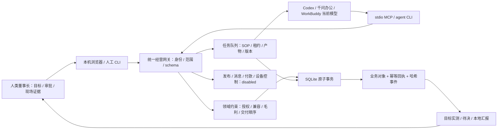

# 全屋智能门店经营业务与四层实现矩阵

## 覆盖率声明

- 范围内文件总数：161；精读：122；机检/脚本解析：39；抽样：0；未读：0。精读中67项为当前SHA一致的历史完整阅读，55项为本任务完整阅读。
- 当前深化任务范围与每个文件的阅读方式、当前 SHA-256、保留精读依据和裁剪理由见 [industry-read-coverage.json](evidence/smart-home-depth/industry-read-coverage.json)。范围是行业资产、所追踪运行时、直接装配与客户端投影依赖、CI接入复核的7份文件和本矩阵，不能表示整个继承仓库已精读。
- 旧任务的行业与 PostgreSQL 兼容清单保留在原证据目录，是历史阅读与历史验证。仅当前文件 SHA 与已精读版本相同的项保留 A 级；本轮修改的运行时和新岗位规程另外完整阅读。历史宿主回执不算本次深化任务实测。
- 机器生成的行业 JSON、目录快照、其他代理负责的 UI/测试和广域装配器关联范围按 B 级记录，不把机检或计数表述成精读。未读/抽样及原因在对应清单逐文件列出。

本文使用 A＝完整代码/规程阅读、B＝全量解析和实测结果汇总、C＝抽样、D＝设计假设或未验证。文件数量是阅读方式记录，不能代表理解度或生产验收通过率。来源清单中的网页正文与搜索索引另列，不能替代源码证据。

## 产品与使用者

**[A]** 本产品的默认行业包是 `smart-home`，面向全屋智能门店老板、门店顾问、方案/工程/售后人员。经营入口以客户线索、现场证据、方案、报价和交付为中心，当前 AI 工作台模型通过 CLI/MCP 领取业务任务，确定性运行时校验并保存结构化产物。依据：[产品清单](../product.manifest.json)、[运行时网关](../bundles/smart-home/runtime/index.mjs) `createBusinessEngine`。

**[D]** 试点假设为独立门店或少量门店、既有设备销售与安装团队、老板可以核实报价和现场材料。用它解决三种损失：来源不清的线索交接、未核实设备条件却提前报价、交付与售后缺记录导致反复追问。价值判据是同一业务输入能找到负责人、前置条件、产物和未闭事项；本文不采用节省工时、增收比例或成交保证作为已实现指标。

**[A]** 默认独立入口使用本机 SQLite 与当前宿主模型，无额外模型 API 调用；继承的 WorkLoom 平台、PostgreSQL、三端客户端与桌面发行仍各有运行链。它们共用行业资产，但 native 的 task/approval/local.sqlite.commit 不是旧平台的线程、tRPC 审批和数据库事件。依据：[AI工作台接入](AI-WORKBENCH.md)、运行时 `catalog`、[存储](../bundles/smart-home/runtime/storage.mjs) `BusinessStorage.transaction`。

## 成都虚构门店与行业知识背景

**[B]** `library/industry-context.json` 是唯一行业背景来源，含 storeProfile、productReference、experienceGuide、channelGuide、officialReferences、syntheticDisclosure 六节。蜀光智家·成都高新体验店是虚构门店，3个服务圈、6个体验区、8个场景、3条路线、6个渠道是明确标识的设计背景，不是查询到的真实店面、客户和经营效果。官方产品参考7项只供知识检索，quoteEligible=false、compatibilityEvidence=false；实际沙箱报价使用独立的 SYN-SG-* 合成SKU。

**[A]** `industry.context` 读取时核对manifest声明、文件SHA、六节结构并拒绝秘密/明文联系信息；响应附 assetDigest、sourceAsset、externalVerification=false。静态资料有来源链接和读取日期，不证明今天所有厂商功能仍可用。运行时没有替模型访问官网，也没有厂商设备/账号连接器。依据：[assets.mjs](../bundles/smart-home/runtime/assets.mjs) `readIndustryContext`。

| 门店经营环节 | 背景中明确的行为 | 对应资料与下一步 |
| --- | --- | --- |
| 找客 | 水电前、精装补充、入住轻改造、伙伴转介分别判断适配与来源 | 只形成合法需求主题或有许可的线索草案，未知字段继续确认 |
| 到店 | 入户、照明、客厅中控、环境、卧室、网络交付六区 | 按路线准备问题与候选时间，真实到店由客户与人员证据形成 |
| 设计 | 生活动作、已有设备、空间点位、回路与手动恢复分别核对 | customer→survey→solution→pointPlan→design，不能从协议名推兼容 |
| 工程 | 图纸与技术交底、材料、安装、联调、培训和验收分别列资料 | construction与project现场链；缺专业来源不把计划记完工 |
| 合同 | 报价内容与合同范围、付款计划、排除和变更规则分别批准 | quote审批→contract审批→客户签署引用；合同金额不计到账 |
| 经营 | 渠道成本、应收计划、库存、产能、回访和问题按来源勾稽 | business observation/schedule；没有实际资金或外发回执 |

## 需求、假设与候选方案

| 类别 | 要求 | 当前实现或验证边界 | 证据 |
| --- | --- | --- | --- |
| 功能 | 获客归因、资格、授权、内容草稿、体验计划 | 固定获客工作流，客户确认与外发分别保存状态 | A：`BusinessWorkflows.applyArtifact` |
| 功能 | 勘测、BOM、场景、兼容、报价、人审 | 双SKU精确版本、网络/电气校验，整数分计算，审批绑定digest | A：`BusinessDomain.buildSolution/createQuote/decideApproval` |
| 功能 | 采购、安装、调试、验收、售后 | 顺序依赖和人类证据，采购记录不代表支付 | A：`recordProcurement/recordCommissioning/recordAcceptance` |
| 功能 | 老板目标、总经理拆解、岗位任务、汇报与纠偏 | 管理动作排入employee-work；人类可暂停/恢复目标 | A：`BusinessWorkflows.start/applyArtifact`、`goal.instruct` |
| 接入 | 当前宿主模型、CLI、MCP、本机浏览器 | 三种入口共享网关，MCP固定agent，生成项目配置 | A：接入文档、HTTP边界；B：宿主进程证据 |
| 一致性 | 写入可重放、并发冲突明确、失败回滚 | `BEGIN IMMEDIATE`，幂等键、旧store/SKU expectedVersion、事务原子提交 | A：存储实现；B：并发测试结果 |
| 规模 | 初期少量门店、同机低并发写入 | 本地同步SQLite；对象list分页上限500，snapshot默认每类100 | A：schema/存储；D：试点规模假设 |
| 延迟 | 操作错误及时可见，宿主超时可恢复 | DB忙等待5秒、HTTP请求15秒、租约30–3600秒；实际大数据p95未测 | A：存储/HTTP/schema；D：性能未验证 |
| 数据量 | 不把分页结果误当全量经营账 | 业务聚合使用当前范围全部对象；每次交易完整校验账本，长账性能待测 | A：`goalReport`、`verify`；D：长期性能 |
| 隐私 | 不在经营对象保存明文联系信息或账号密钥 | opaque contactRef、模式检测、禁止敏感字段；用户文档仍视为数据 | A：`rejectSecretsAndPII`，不是完整DLP认证 |
| 责任 | 报价承诺、授权和现场签收由人类承担 | 真实TTY确认，浏览器owner会话和CSRF；MCP不能提权 | A：HTTP/Common、domain.human |
| 外部事实 | 本地写入与实际平台/设备结果分别表述 | externalVerified=false；发布/消息/付款/设备控制disabled | A：网关/domain；B：结果证据 |

| 候选方案 | 优点 | 成本、风险与前提 | 选择 |
| --- | --- | --- | --- |
| 直接沿用酒店LLM服务与线程调度，在业务prompt中换行业 | 可复用既有服务端线程、UI、审计和模型路由 | 宿主内置模型不等于旧LLM_PROVIDER；酒店领域对象和线程成功不能证明BOM/报价/现场交付；需要新的模型连接或付费API | D：不采用为默认经营执行链 |
| 独立行业确定性适配器 + 宿主CLI/MCP + 复用行业包与三端入口 | 当前模型直接执行任务，无新增模型密钥；领域校验、审批与本地回执有专门契约；外部动作默认关闭 | 两种账本口径须显式区分；本机owner信任边界由OS/TTY承担；大数据/远程协作/真实平台连接器另需实现 | D：选定，A：已实现此运行链 |

选定第二种方案，是因为用户要求当前工作台内置模型参与实际业务步骤，又要求不伪造客户、兼容性或外部执行。独立运行时把模型产物与确定性业务约束分开，继承平台保留为资产、三端与治理兼容层。

## 第一层：用户旅程与核心流程

| 具体场景 | 前置记录 | 用户与数字员工的动作 | 成功定义 | 缺失/拒绝路径 | 证据 |
| --- | --- | --- | --- | --- | --- |
| 线上咨询准备到店体验 | 门店、线索、用途授权与当前已知字段；预算/装修阶段可以未知 | 接待员核对资格；选题员产草稿；顾问产拟议体验；总经理汇报 | 本地qualified线索、proposed体验、草稿与报告可读回；不等同到店/成交 | 信息缺失或fit=false时跳过内容/体验并报告；没有appointment授权拒绝 | A：growth-acquisition |
| 装修中客户申请全屋方案 | 人类勘测、厂家SKU/安装约束、精确版本兼容证据 | 设计师产BOM/场景；报价员产成本/售价/折扣草案；店主审digest | 方案validated-local、报价awaiting-approval；通过后准备交付计划 | 零线、负载、网络、兼容缺依据阻断；财务红线不得人审覆盖 | A：project-delivery、buildSolution |
| 合同项目进场验收 | 批准且未过期报价、合同、完整BOM到货 | 人类登记安装安全项、逐场景调试、客户培训和凭据交接 | 项目accepted-local-record且零未闭问题；外部事实仍需人工核实 | 缺采购不能装；漏场景/失败不能验；客户不接受或缺培训保持pending | A：project/create与现场操作 |
| 已交付项目设备离线 | 项目、售后工单、用途/责任边界 | 售后员分级与处置计划；专业人员现场服务；客户确认与未来回访 | 本地resolved、服务证据和回访计划齐备 | 安全/隐私必须人类专业升级；禁止带电拆箱或绕过安全系统 | A：aftercare-loop |
| 老板要求本月改善经营 | 门店、可计量目标、现存业务对象 | 总经理核对实测指标、分配岗位技能；宿主领取准备任务；老板改目标或暂停 | 管理诊断值与实时指标相等；岗位任务实际入队；报告含差距与待决 | 子目标缺lead/survey/ticket为waiting-input；外部预算/发布授权不自动获得 | A：management-loop |
| 只知姓氏、微信ref或楼盘的首次咨询 | store与至少一个可识别字段，其余未知 | 找客专员整理来源；线索完善专员形成非空有依据的patch和确认问题 | lead存在，leadEnrichment待人类确认；未知不被补成事实 | 没有可提议事实则task.fail等待输入；模型proposal不改授权或qualified | A：lead.create/lead.enrich、proposeLead |
| 已确认客户要求修改窗帘点位 | customer、survey、solution、当前pointPlan/design/construction | 销售助手列差异；工程岗位生成连续新版本并重新核对合同 | 新版有准确previousRevisionId与referenceSnapshots，旧版保留 | 跳版本、越房间坐标、旧设计或不符BOM拒绝；未人审不作承诺 | A：BusinessDepth.revision/assertLatest |
| 店长准备销售陪练与交班 | 当前同店对象、授权脱敏材料或synthetic训练情境 | sales-coach与store-manager-assistant领取各自技能准备任务 | 练习、待办、资源冲突与nextActions留报告，实际外发/排班未执行 | 跨店、错技能、旧版本、秘密与租约失效拒绝 | A：employee-work/claim/submit |

**[A]** 五种业务指标为 qualified-leads、experience-plans、accepted-projects、resolved-aftercare、management-reports。`goalReport` 的口径是 operational-local-records-excluding-imported-history：导入的合成历史不会直接计本轮业绩；历史线索须有新 operationalAssessmentAt，历史项目/售后须有新执行记录才进入对应指标。management-reports按当前goal计数。它仍是当前工作区门店的累计本地记录，没有日期窗口筛选、真实营收、实际到账或完整转化率；pendingApprovals覆盖当前工作区。historicalSynthetic单列历史数量。依据：[domain.mjs](../bundles/smart-home/runtime/domain.mjs) `goalReport`。

## 第二层：能力、数据模型与接口

### 27类逻辑对象

**[A]** 每个对象共有 id/type/tenantId/workspaceId/dataMode/version/createdAt/updatedAt。金额用非负安全整数分；真实数据和sandbox不能在同一tenant/workspace切换口径。对象关系通过当前范围读取与业务校验维护，物理库没有为每个逻辑类型单独建表。

| 类型 | 核心字段/引用 | 版本、状态与校验 |
| --- | --- | --- |
| store | name/city/serviceAreas/minMarginRatio/maxDiscountRatio | 旧记录必须expectedVersion，阈值只可收紧；变更阈值需人类 |
| sku | manufacturer/model/category/protocol/firmwareVersion/costCents/priceCents/evidence/installationRequirements | live安装参数必填；inactive不能进方案；价格不得低于记录成本 |
| compatibility | leftSkuId/rightSkuId/result/conditions/evidence/expiresAt/skuVersions/firmwareVersions | 精确版本与期限，当前incompatible证据优先阻断 |
| lead | storeId/alias/contactRef/channel/campaignRef/intent/budgetCents/renovationStage/consent | 首记触点归因；可只知姓氏/联系ref/楼盘；用途未知默认unknown；补全有版本和来源历史 |
| experience | leadId/startsAt/durationMinutes/scenes/confirmationEvidence | proposed与customer-confirmed分开；外部通知未启用 |
| survey | leadId/rooms[].circuits/network/hazards/evidence | 人类现场记录；房间/房内回路ID唯一 |
| solution | surveyId/bom/scenes/compatibilityIds/exclusions/skuSnapshots/costCents | 方案validated-local，physicalFeasibilityVerified=false |
| quote | solutionId/劳动成本与售价/discountCents/validUntil/terms/commitmentDigest | 毛利/折扣policyViolations；draft→awaiting-approval→approved/rejected |
| approval | targetType/targetId/contentDigest/reason/expiresAt/summary/decision | pending/approved/rejected/expired；7天上限；人类身份与摘要 |
| project | quoteId/solutionId/leadId/storeId/contractEvidence/dueAt/milestone | contract→procurement→installation→commissioning→acceptance |
| procurement | projectId/items[].skuId/quantity/serialRefs/evidence | 累计数量不超BOM；序列引用不重复；不代表下单/支付 |
| commissioning | projectId/results[].sceneId/passed/observation/evidence | 全场景一次一条结果；任一失败不推进验收 |
| acceptance | projectId/customerAccepted/trainingDelivered/credentialsTransferred/outstandingIssues/evidence | 四项条件共同决定acceptedLocally；externallyVerified=false |
| aftercare | projectId/category/severity/description/dueAt/triage/resolutionPlan/evidence/followupAt | 安全/隐私high或critical；人类服务与客户确认后resolved |
| content | storeId/channel/title/body/claims/skuIds/piiFree/approvalId | draft→awaiting-approval→approved-pending-connector；绝对承诺拒绝 |
| goal | storeId/title/metric/target/deadline/constraints/status/lastInstruction | active/paused/waiting-input；外部执行权未授予 |
| workflow | kind/goalId/storeId/refs/taskIds/phaseIndex/waitingFor/employeeId/skillId/objectRefs | running/waiting-approval/waiting-evidence/completed/failed；同输入去重 |
| task | workflowId/employee/skill/skillAsset/outputSchema/status/attempts/lease*/artifact/modelTrace/failureHistory | ready/leased/completed/failed/cancelled；任务实体存租约hash，完整领取响应留在幂等缓存；完整SOP随领取提供 |
| report | kind/goalId/workflowId/summary/risks/nextActions/measuredMetrics/evidence | 业务决策包或employee-work准备报告；不伪装成外部/物理/付款/视频执行 |
| leadEnrichment | leadId/storeId/baseVersion/proposedPatch/confirmationQuestions/supportingRecord | pending-human-confirmation；customerFactsApplied=false，consentGranted=false |
| customer | leadId/household/preferences/decisionProcess/communication/source/evidence/revisionHistory | 事实源需人类确认；禁止重挂线索；同lead只建一档；旧记录expectedVersion |
| pointPlan | customerId/surveyId/revision/previousRevisionId/rooms尺寸/points毫米坐标 | 房间、点位唯一；坐标在房间内；SKU/回路须存在；referenceSnapshots与旧版摘要 |
| design | customerId/solutionId/pointPlanId/revision/rationale/sceneNotes/exclusions | 同客户同勘测；每场景一次；每房间/SKU的设备点位数量与BOM完全一致，设备点必须有SKU；网络/插座预留辅助点可不绑定SKU；draft-local-validated |
| construction | designId/revision/milestones/materials/qualityChecks/risks | 采购→安装→调试→验收且日期递增；材料精确匹配BOM；planned-local、fieldWorkPerformed=false |
| contract | customerId/quoteId/designId/constructionId/numberRef/scope/paymentSchedule/条款 | 付款计划合计等于报价；quoteDigest与commitmentDigest；独立人审和signed-local-record，不执行资金 |
| business | storeId/kind/occurredAt/summary/amountCents/quantity/objectRefs/evidence | 八种观察或计划口径；金额整数分；引用同店；actualCashMovement=false |
| scenario | datasetId/fixtureDigest/anchorDate/objectReferences/operationTrail/summary | 沙箱原子导入、namespace隔离和恢复核对；noModelArtifactsImported=true |

### SQLite物理表与索引

| 表 | 字段 | 主键/索引/约束 |
| --- | --- | --- |
| scope_registry | tenant, workspace, data_mode | PK(tenant,workspace)，首次口径后不可复用为另一dataMode |
| entities | tenant, workspace, type, id, version, doc | PK(tenant,workspace,type,id)，version>0，FK范围表；STRICT |
| business_events | seq, tenant, workspace, event_id, payload, hash, prev_hash, created_at | seq主键，event_id UNIQUE，events_scope(tenant,workspace,seq)，禁止UPDATE/DELETE触发器 |
| idempotency | tenant, workspace, key, request_hash, result, event_id | PK(tenant,workspace,key)，FK事件，禁止UPDATE/DELETE触发器 |

**[A]** 存储启用WAL、synchronous=FULL、trusted_schema=OFF和5秒busy timeout。业务写入在BEGIN IMMEDIATE中检查账本、执行领域操作、更新投影、附加事件、附加回执再COMMIT；失败ROLLBACK。同幂等键同请求/同actor读回旧结果，不同内容或actor返回IDEMPOTENCY_CONFLICT。SHA-256链加投影/回执交叉校验能发现本地损坏，不能抵御拥有OS管理员权限的人同时重写整个数据库，也没有外部不可抵赖锚。

**[A]** `task` 实体保存 `leaseTokenHash`；不可变 `idempotency.result` 保存完整领取响应，包含原始明文 `leaseToken` 和当时的任务上下文，用于同请求、同actor/渠道重放。缓存没有单独加密，旧租约过期或完成后仍可能在数据库和备份中保留。`entity.get/list`、`state.snapshot`、`task.list`、`workflow.get` 移除任务租约hash；`ledger.list` 返回事件中的请求/结果/实体摘要，不返回完整幂等响应或原始token。重放旧响应不续期，`task.submit/fail` 仍校验当前状态、操作者、token hash与期限。依据：`BusinessStorage.transaction/events`、`BusinessDomain.safe/read`、`BusinessWorkflows.claim/lease`；**[B] 历史实测：** [隔离存储与读取实测](evidence/lease-storage-boundary.json) 23项通过且没有记录token值。这是并发契约和本机敏感数据边界，不能解释为独立身份认证或token从未明文落盘。

### 51项业务操作

**[B]** 下表必填字段由当前 `OPERATION_CATALOGUE` 导出；完整类型、长度、枚举和嵌套schema见 [native-operations.json](../bundles/smart-home/library/native-operations.json)。**[A]** 结果描述按 `BusinessDomain.execute` 与 `BusinessWorkflows.execute/applyArtifact` 精读核对。所有写操作均需 idempotencyKey；risk=review表示审计风险分类，实际人类门禁由对应方法检查，不能认为所有review操作都由同一个审批对象解锁。

| 操作 | 权限风险 | 必填字段 | 结果与边界 |
| --- | --- | --- | --- |
| `status` | 只读 | 无 | 运行口径、连接器状态、对象计数与账本校验 |
| `catalog` | 只读 | 无 | 51项操作、5类工作流、岗位技能归属与输入schema |
| `entity.list` | 只读 | `type` | 当前工作区该类型的分页对象；拒绝未知类型 |
| `entity.get` | 只读 | `type`, `id` | 当前工作区指定对象；不存在返回NOT_FOUND |
| `state.snapshot` | 只读 | 无 | 27类对象的total与items；单类上限500 |
| `ledger.verify` | 只读 | 无 | 事件、投影、幂等回执的交叉校验与issues |
| `ledger.list` | 只读 | 无 | 当前工作区事件序号、载荷与hash |
| `approval.list` | 只读 | 无 | 审批有效状态与摘要；到期状态动态计算 |
| `task.list` | 只读 | 无 | 任务状态、岗位、技能、产物与失败历史；隐藏租约hash |
| `workflow.get` | 只读 | `workflowId` | 流程状态、关联对象、任务、waitingFor和跳过阶段 |
| `goal.report` | 只读 | `goalId` | 排除导入历史的本门店累计本地指标、单列historicalSynthetic、目标差距与当前工作区待审批。 |
| `store.upsert` | auto；owner,operator,agent | `id`, `name`, `city`, `serviceAreas`, `minMarginRatio`, `maxDiscountRatio`, `idempotencyKey` | 门店规则；旧记录必须expectedVersion，财务红线只可收紧 |
| `sku.upsert` | auto；owner,operator,agent | `id`, `manufacturer`, `model`, `category`, `protocol`, `firmwareVersion`, `costCents`, `priceCents`, `evidence`, `idempotencyKey` | 设备版本、价格成本、证据与安装约束；live禁止猜电气参数 |
| `compatibility.record` | auto；owner,operator,agent | `id`, `leftSkuId`, `rightSkuId`, `result`, `conditions`, `evidence`, `expiresAt`, `idempotencyKey` | 精确双SKU版本、固件、兼容结果、条件与期限 |
| `lead.create` | auto；owner,operator,agent | `id`, `storeId`, `idempotencyKey` | id/storeId之外至少一项姓氏、别名、联系ref或楼盘；预算/装修可未知，授权默认unknown；模型事实和内部来源不得冒填。 |
| `lead.authorize` | auto；owner,operator,agent | `leadId`, `status`, `purposes`, `evidence`, `idempotencyKey` | 用途授予/撤回独立留痕；live需要人类确认 |
| `experience.schedule` | auto；owner,operator,agent | `id`, `leadId`, `startsAt`, `durationMinutes`, `scenes`, `idempotencyKey` | 拟议体验计划；customer-confirmed须客户证据和人类 |
| `survey.record` | review；owner,operator | `id`, `leadId`, `renovationStage`, `rooms`, `network`, `hazards`, `evidence`, `idempotencyKey` | 现场勘测记录；房间/回路ID唯一且需要人类证据 |
| `solution.build` | auto；owner,operator,agent | `id`, `surveyId`, `name`, `bom`, `scenes`, `compatibilityIds`, `idempotencyKey` | BOM、场景、精确兼容/电气/网络校验与SKU快照 |
| `quote.create` | auto；owner,operator,agent | `id`, `solutionId`, `laborCostCents`, `laborPriceCents`, `discountCents`, `validUntil`, `terms`, `idempotencyKey` | 整数分复算、毛利/折扣诊断与承诺digest；未形成外部承诺 |
| `quote.request_approval` | review；owner,operator,agent | `quoteId`, `expiresAt`, `reason`, `idempotencyKey` | 待审批快照；期限不超过报价且最多7天 |
| `approval.decide` | review；owner | `approvalId`, `decision`, `reason`, `contentDigest`, `idempotencyKey` | 人类按digest批准或拒绝；红线违规不能override |
| `project.create` | review；owner,operator | `id`, `quoteId`, `contractEvidence`, `dueAt`, `idempotencyKey` | 批准报价和签约来源形成项目；有customer档案的线索必须关联当前 signed-local-record 合同。 |
| `procurement.record` | review；owner,operator | `id`, `projectId`, `items`, `evidence`, `idempotencyKey` | 累计到货数量与序列引用；超BOM/重复serial拒绝 |
| `project.milestone` | review；owner,operator | `projectId`, `milestone`, `evidence`, `professionalRef`, `safetyChecklist`, `idempotencyKey` | 采购完整后的安装记录；安全项须全true |
| `commissioning.record` | review；owner,operator | `id`, `projectId`, `results`, `evidence`, `idempotencyKey` | 全部场景逐项测试；失败回到installation |
| `acceptance.record` | review；owner,operator | `id`, `projectId`, `customerAccepted`, `trainingDelivered`, `credentialsTransferred`, `outstandingIssues`, `evidence`, `idempotencyKey` | 客户接受/培训/凭据交接/零未闭问题共同判定 |
| `aftercare.open` | auto；owner,operator,agent | `id`, `projectId`, `category`, `severity`, `description`, `dueAt`, `idempotencyKey` | 工单、等级和门店归属；安全/隐私须high或critical |
| `aftercare.resolve` | review；owner,operator | `ticketId`, `resolution`, `evidence`, `customerConfirmed`, `followupAt`, `idempotencyKey` | 人类服务证据、客户确认和未来回访时间 |
| `content.create` | auto；owner,operator,agent | `id`, `storeId`, `channel`, `title`, `body`, `claims`, `skuIds`, `piiFree`, `idempotencyKey` | 本地草稿、声明证据、去PII声明；拒绝绝对兼容/安全承诺 |
| `content.request_publication` | review；owner,operator,agent | `contentId`, `expiresAt`, `reason`, `idempotencyKey` | 内容审批快照；连接器仍disabled |
| `content.publish` | block；owner,operator,agent | `contentId`, `approvalId`, `idempotencyKey` | 始终拒绝CONNECTOR_DISABLED；不产生外部发布回执 |
| `goal.create` | auto；owner,operator,agent | `id`, `storeId`, `title`, `metric`, `target`, `deadline`, `constraints`, `idempotencyKey` | 可计量目标、约束、期限；授权仅local-planning-only |
| `goal.instruct` | review；owner | `goalId`, `instruction`, `action`, `idempotencyKey` | 人类调整目标、暂停/恢复与指令历史 |
| `workflow.start` | auto；owner,operator,agent | `id`, `kind`, `goalId`, `idempotencyKey` | 固定业务流程或指定岗位技能准备流程；同输入去重 |
| `workflow.tick` | auto；owner,operator,agent | `idempotencyKey` | 确定性推进、期限/租约恢复；modelCalls=0 |
| `task.claim` | auto；owner,operator,agent | `idempotencyKey` | 岗位规程、上下文、outputSchema与一次性租约 |
| `task.submit` | auto；owner,operator,agent | `taskId`, `leaseToken`, `artifact`, `modelTrace`, `idempotencyKey` | schema/租约/对象版本校验、产物应用、依赖推进与回执 |
| `task.fail` | auto；owner,operator,agent | `taskId`, `leaseToken`, `error`, `retryable`, `idempotencyKey` | 有限重试或终态失败，保留failureHistory |
| `industry.context` | 只读 | 无 | 封印的六节背景或指定一节，返回assetDigest/sourceAsset，官方参考不证明兼容、授权或商品价格。 |
| `scenario.list` | 只读 | 无 | 可导入沙箱数据集、版本、fixtureDigest、来源与模拟披露。 |
| `scenario.import` | review；owner,operator | `datasetId`, `idempotencyKey` | owner/operator沙箱原子导入合成历史与ready队列；不导入模型完成、人审、外发、资金或现场执行。 |
| `lead.enrich` | auto；owner,operator,agent | `leadId`, `expectedVersion`, `patch`, `source`, `evidence`, `idempotencyKey` | source=model-proposal仅存leadEnrichment；事实应用需人类、准确expectedVersion、非空白名单patch与evidence；授权另操作。 |
| `customer.upsert` | review；owner,operator | `id`, `leadId`, `household`, `preferences`, `decisionProcess`, `communication`, `source`, `evidence`, `idempotencyKey` | 客户事实档案、原内容历史与线索版本；同lead唯一，旧档必须expectedVersion，禁止换归属。 |
| `pointPlan.record` | auto；owner,operator,agent | `id`, `customerId`, `surveyId`, `revision`, `rooms`, `points`, `evidence`, `idempotencyKey` | 同客户勘测、毫米坐标与连续版本；房间/点ID、尺寸、回路与有效SKU校验，不测量或控制设备。 |
| `design.record` | auto；owner,operator,agent | `id`, `customerId`, `solutionId`, `pointPlanId`, `revision`, `rationale`, `sceneNotes`, `exclusions`, `evidence`, `idempotencyKey` | 同客户、同勘测的方案与点位；场景全覆盖，每房间/SKU设备点数量与BOM完全一致；未绑定SKU的设备点拒绝，网络/插座预留辅助点可保留；保存准确版本摘要。 |
| `construction.record` | auto；owner,operator,agent | `id`, `designId`, `revision`, `milestones`, `materials`, `qualityChecks`, `risks`, `evidence`, `idempotencyKey` | 当前设计、连续版本、四工序和时间顺序、责任岗、BOM精确数量与质量资料；未执行现场。 |
| `contract.create` | auto；owner,operator,agent | `id`, `customerId`, `quoteId`, `designId`, `constructionId`, `numberRef`, `scope`, `paymentSchedule`, `warrantyTerms`, `changeTerms`, `exclusions`, `idempotencyKey` | 引用当前客户/报价/设计/施工；整数分付款计划等于报价，冻结digest；只是本地合同草案。 |
| `contract.request_approval` | review；owner,operator,agent | `contractId`, `expiresAt`, `reason`, `idempotencyKey` | 在当前报价批准后请求独立合同人审，期限不超过报价；绑定合同digest与工程版本。 |
| `contract.record_signing` | review；owner,operator | `contractId`, `evidence`, `idempotencyKey` | 当前合同/报价批准与客户来源证据形成signed-local-record；人类提供证据，externallySigned=false。 |
| `business.record` | review；owner,operator | `id`, `storeId`, `kind`, `occurredAt`, `summary`, `objectRefs`, `evidence`, `idempotencyKey` | 同店经营观察/计划与对象版本引用；按kind要求金额或数量；不产生现金、支付或外部回执。 |

### 三种调用通道与HTTP契约

**[A]** Node API：`createBusinessEngine({dataDir,tenantId,workspaceId,dataMode})` 返回 `catalog()/call(operation,input,actor)/close()`。通道层验证actor，业务输入不得自选身份。CLI：`node scripts/business-management.mjs describe <operation>` 读取schema；`call <operation> --input-file <path>`固定agent；人工审批和现场登记走真实TTY的 `approve` / `human-call`。完整命令与配置见 [AI-WORKBENCH.md](AI-WORKBENCH.md)。

**[A]** 本机HTTP默认127.0.0.1:9393，仅允许当前localhost/127.0.0.1 Host、同源Origin，拒绝跨站请求和查询参数；状态API不提供远程身份系统。JSON请求需application/json，传输限1MiB，业务输入限1,000,000字节。错误统一 `{error:{code,message}}`，消息截断与秘密脱敏。

| 方法/路径 | 参数 | 返回/失败 |
| --- | --- | --- |
| GET /api/catalog | 无 | 裸catalog对象，包含operations/workflows/workforce/externalConnectors |
| GET /api/state | 无 | `{operation:'state.snapshot',data:{type:{total,items}}}` |
| GET /api/status | 无 | `{operation:'status',data:{scope,counts,ledger,connectors}}` |
| POST /api/call | `{operation,input}` | agent调用结果；成功写返回receipt/replayed |
| POST /api/owner/session | `{}`，同源Origin，真实TTY服务 | 202 `{status:'pending',requestId}`与HttpOnly/Strict cookie；无TTY拒绝 |
| GET /api/owner/session | 会话cookie | anonymous/pending/authorized；已授权返回csrfToken与expiresAt |
| POST /api/owner/call | `{operation,input}`、cookie、X-BMS-CSRF、同源Origin | owner/humanConfirmed调用；申请5分钟、授权30分钟 |
| DELETE /api/owner/session | cookie；已授权时需X-BMS-CSRF | 清除会话与cookie |

**[A]** stdio MCP 工具名为 bms_ + 操作名点号替换为下划线，固定agent，过滤人类专属和block操作；tools、resources、prompts帮助宿主读取目录和任务。模型发生在宿主，不在tick/engine里。协议兼容与宿主配置不等于千问办公、WorkBuddy已真机验收；本次真实宿主证据是Codex，另外两种客户端仍未验证。

### 异常、并发与恢复路径

| 触发条件 | 错误/状态 | 恢复动作 | 证据 |
| --- | --- | --- | --- |
| 跨租户/工作区actor，MCP伪造owner | TENANT_SCOPE_MISMATCH / MCP_ACTOR_SPOOFING / PERMISSION_DENIED | 返回本工作区身份，禁止把输入当授权 | A：网关 |
| 旧门店/SKU缺版本或版本冲突 | VERSION_REQUIRED / VERSION_CONFLICT | 重新读取对象后人工判断再提交 | A：domain/storage |
| 同幂等键不同请求/actor | IDEMPOTENCY_CONFLICT | 保留原回执，新的业务意图使用新键 | A：storage |
| SQLite竞争写锁 | DATABASE_BUSY，503 | 使用相同幂等键有限重试；失败事务回滚 | A：storage |
| 账本、投影或回执摘要不一致 | LEDGER_INTEGRITY_FAILURE | 禁止写入/展示业务事实；核对备份与原始证据 | A：verify/网关 |
| 兼容过期、SKU变更、新冲突证据 | COMPATIBILITY_EXPIRED / COMPATIBILITY_STALE / COMPATIBILITY_CONFLICT / SOLUTION_SKU_STALE | 补精确厂家证据，重新建方案/报价 | A：buildSolution/assertSolutionCurrent |
| 电气/网络条件不满足 | NEUTRAL_WIRE_REQUIRED / CIRCUIT_OVERLOAD / VOLTAGE_REQUIREMENT_UNMET / NETWORK_REQUIREMENT_UNMET | 专业人员重新勘测或改BOM，禁止猜现场值 | A：buildSolution |
| 审批已过期、摘要不同或财务红线违规 | APPROVAL_EXPIRED / APPROVAL_CONTENT_MISMATCH / QUOTE_POLICY_BLOCKED | 新方案与报价重新请求人审；阈值不可放宽 | A：decideApproval |
| 租约超时/被其他actor提交 | TASK_LEASE_EXPIRED / INVALID_TASK_LEASE | tick恢复，重新领取；有限次数耗尽则failed | A：lease/claim/tick |
| 岗位技能不归属、引用跨店或对象改变 | EMPLOYEE_SKILL_MISMATCH / STORE_SCOPE_MISMATCH / WORK_REFERENCE_STALE | 使用真实责任岗位和当前对象版本新建准备任务 | A：workforce/start |
| 模型artifact不合schema或编造指标 | INVALID_INPUT / METRIC_EVIDENCE_MISMATCH | 保留原状态，修正结构/来源后再提交 | A：submit/applyArtifact |
| 授权撤回、目标暂停/过期 | CONSENT_REQUIRED / GOAL_PAUSED / GOAL_EXPIRED | 人类核对用途/目标；到期取消ready/leased任务 | A：domain/workflows |
| 缺现场前置或安全项 | MILESTONE_ORDER / INSTALLATION_SAFETY_INCOMPLETE / INCOMPLETE_COMMISSIONING | 专业人员补有效证据，失败阶段不推进 | A：现场方法 |
| 尝试外部发布或API换URL | CONNECTOR_DISABLED / NOT_FOUND / FORBIDDEN_ORIGIN | 保持待外部执行；不能用批准模拟发布 | A：网关/HTTP |
| 没有任何线索识别信息、空补充patch或移交建议冒称已全 | LEAD_IDENTIFIER_REQUIRED / EMPTY_LEAD_PATCH / HANDOFF_READINESS_MISMATCH | 保留未知，补客户来源；没有事实可提议则fail等待，不编完整率 | A：lead.create/proposeLead/leadCompleteness |
| 工程资料跳版本、引用改变或被新版本取代 | REVISION_CHAIN_INVALID / DOCUMENT_REFERENCE_STALE / DOCUMENT_REVISION_SUPERSEDED | 从当前客户/勘测/方案重做连续点位、设计与施工版本，重新核对承诺 | A：BusinessDepth.revision/assertLatest/checkSnapshots |
| 点位越房间、设备不属BOM、缺SKU、数量/场景/材料漏项或重复 | POINT_OUTSIDE_ROOM / POINT_SKU_OUTSIDE_BOM / DESIGN_POINT_SKU_REQUIRED / DESIGN_POINT_BOM_MISMATCH / DESIGN_SCENE_COVERAGE / CONSTRUCTION_BOM_MISMATCH | 草图可暂不完整；要成为核验设计须把每房间/SKU设备点数量补到精确BOM，并保留场景、材料与手动回退资料；不以图显示成功代替可施工 | A：pointPlan/design/construction |
| 合同付款计划不等报价、报价/合同未批准或旧引用 | CONTRACT_PAYMENT_TOTAL_MISMATCH / APPROVED_QUOTE_REQUIRED / APPROVED_CONTRACT_REQUIRED / CONTRACT_REFERENCE_MISMATCH | 改草案后重新请求独立人审；签署仍需客户证据 | A：contract.create/request_approval/record_signing |
| live导入历史、未来anchor、命名冲突或不同场景版本 | SCENARIO_IN_LIVE_BLOCKED / INVALID_SCENARIO_ANCHOR / SCENARIO_OBJECT_COLLISION / SCENARIO_VERSION_CONFLICT | 使用明确新sandbox与当前数据集；保留原场景，不覆写业务对象 | A：importSyntheticScenario |

## 第三层：数字员工、技能与编排

### 27岗位、49技能及唯一责任归属

**[A]** 原20份preset/35份SKILL.md保留当前SHA一致的精读依据，新7份preset/14份SOP另行完整阅读，校对了owner、技能绑定、工具、write_back和岗位协议。运行时从 [workforce.json](../bundles/smart-home/library/workforce.json) 读取唯一归属，验证manifest声明与SHA-256，并检查每个SOP的name/owner/version/fence_bindings。claim包含封印后的完整SOP、技能digest和对象上下文。岗位目录不是自动执行外部平台动作的授权。

| 岗位 | 技能 | 责任 |
| --- | --- | --- |
| `store-ceo` / 门店数字总经理 | `store-diagnosis`, `goal-decomposition`, `owner-briefing` | 将董事长目标拆成获客、交付、售后任务；按证据向董事长汇报差距和待决事项。 |
| `growth-director` / 增长经营主管 | `campaign-review`, `partner-channel` | 经营渠道预算、伙伴合作和线索归因；核对有效线索与签约成本，生成调整建议。 |
| `market-researcher` / 本地市场研究员 | `market-intelligence`, `local-search-presence` | 读取有授权的本地需求、竞品公开信息和搜索证据；记录来源、时间与不确定性。 |
| `content-strategist` / 内容选题主理人 | `content-planning` | 将客户痛点、场景证据和门店服务范围变成分平台选题、脚本与搜索问答草稿。 |
| `video-producer` / 短视频制作员 | `short-video-production` | 编写可拍摄分镜、配音稿、字幕和剪辑说明；核对素材授权，标识模拟与真实实拍。 |
| `social-publisher` / 社媒发布管理员 | `social-publishing` | 整理发布审批和平台素材包；只有已配置连接器且真实回执成立才记录发布完成。 |
| `lead-concierge` / 客户线索接待员 | `lead-qualification`, `customer-consent` | 归集渠道意向、装修阶段、预算区间和服务地域；把用途授权与撤回独立留痕。 |
| `sales-consultant` / 门店方案顾问 | `consultative-sales`, `experience-appointment`, `referral-retention` | 按客户需求安排体验路线与勘测移交；不擅自给价格、兼容性和工期保证。 |
| `solution-designer` / 全屋智能方案设计师 | `solution-design`, `bom-check` | 基于现场勘测设计分房间点位、设备清单、一键场景和条件自动化；标明排除项。 |
| `survey-engineer` / 现场勘测工程师 | `site-survey`, `network-planning` | 接收合格现场人员勘测记录，核对回路、零线、负载、网络和安装约束；不代替现场测量。 |
| `compatibility-engineer` / 兼容性验证工程师 | `compatibility-verification`, `store-demo-health` | 核对设备型号、固件、网关、生态和功能集的精确兼容证据；未知组合保持待核验。 |
| `quote-controller` / 报价与合同审核员 | `quote-margin-control`, `contract-handoff` | 复算设备、施工、服务、折扣与毛利；发起报价承诺审批并对接签约证据。 |
| `project-manager` / 项目交付经理 | `project-scheduling` | 协调采购、进场、安装、调试、验收依赖和变更；缺前置证据不能推进工程里程碑。 |
| `procurement-controller` / 采购与库存管理员 | `procurement-inventory` | 核对批准清单、到货数量、型号版本和序列号；采购记录不等同支付或供应商下单。 |
| `installation-supervisor` / 安装质量主管 | `installation-quality` | 核对持证人员、断电保护、厂家指导、点位照片和装配结果；只记录现场证据。 |
| `commissioning-engineer` / 场景调试工程师 | `scene-commissioning` | 逐场景验触发、行为、失败回退、断网与手动控制；没有测试记录不声明调试成功。 |
| `acceptance-auditor` / 客户验收审核员 | `acceptance-handover` | 核对合同范围、每个场景、客户培训、账号交接与未闭问题；签收必须有客户证据。 |
| `aftercare-specialist` / 售后服务专员 | `aftercare-triage`, `aftercare-resolution`, `customer-followup` | 把离线、误触发、网络、设备、安全和隐私问题分流；按真实服务与客户确认闭环。 |
| `finance-controller` / 经营财务控制员 | `finance-reconcile` | 复核报价、合同、采购凭据、收款与应收差异；不收款、不付款、不自动平账。 |
| `knowledge-steward` / 知识与复盘管理员 | `knowledge-maintenance`, `incident-learning`, `data-import-qa` | 维护设备证据、问答、失败案例与字段映射；版本变更先形成新证据再替换引用。 |
| `prospecting-specialist` / AI找客专员 | `prospect-targeting`, `source-lead-intake` | 把服务区域、装修节点与合法公开需求转成找客方向和来源明确的线索草案；不抓取私人联系方式、不自动私信。 |
| `lead-enrichment-specialist` / AI线索完善专员 | `lead-profile-enrichment`, `customer-handoff-check` | 按线索当前阶段整理已知信息、补充提议与确认问题；模型提议只形成草案，人类确认后才能成为客户事实。 |
| `appointment-coordinator` / AI预约邀约专员 | `appointment-coordination`, `appointment-recovery` | 协调客户意向、展厅路线、人员与时间窗，整理邀约和改期草稿；客户未确认不记到店，连接器未启用不报已触达。 |
| `sales-assistant` / AI销售助手 | `sales-meeting-prep`, `sales-objection-brief` | 为顾问准备客户会谈、需求摘要、方案差异与异议答复；把设计、施工、合同中的未知项和承诺交给责任人。 |
| `sales-coach` / AI销售培训师 | `sales-coaching`, `sales-quality-review` | 用已授权脱敏会谈和模拟角色扮演训练销售，复核信息采集、事实依据、交接质量与承诺边界；训练成绩不等于真实成交能力。 |
| `business-operations-assistant` / AI经营助理 | `operations-daily-control`, `business-data-reconciliation` | 按带来源的经营记录整理每日待办、线索漏斗、项目风险与金额差异；分别报告计划、签约、收款和交付，不自动补账或改经营阈值。 |
| `store-manager-assistant` / AI店长助理 | `store-shift-coordination`, `store-resource-brief` | 协调接待、展厅准备、勘测与施工资源，形成交班和产能冲突清单；排班建议不代替人员到岗、现场检查或店主授权。 |

**[A]** 每个技能规程包含输入、执行步骤、输出、失败与拒绝条件、交接、验收断言及宿主任务协议。新增找客、线索完善、预约、销售助手、陪练、经营助理、店长助理各有2份独立SOP，不用功能名代替实际规程。规程中的内容检查是宿主必须遵守的SOP；确定性runtime只对公开schema、归属、版本、租约、已实现领域规则作机器校验，不能从规程文字推断它已经识别所有伪造来源或执行所有外部能力。

### 五类工作流与15种阶段契约

| 工作流 | 阶段 | 服务目标指标 |
| --- | --- | --- |
| `growth-acquisition` | qualification → content-draft → experience-plan → owner-report | `qualified-leads`, `experience-plans` |
| `project-delivery` | solution → quote → delivery-plan → owner-report | `accepted-projects` |
| `aftercare-loop` | triage → resolution-plan → owner-report | `resolved-aftercare` |
| `management-loop` | diagnose → plan → owner-report | `management-reports` |
| `employee-work` | skill-plan | `qualified-leads`, `experience-plans`, `accepted-projects`, `resolved-aftercare`, `management-reports` |

**[A]** 前四类共14个固定模型阶段。employee-work使用1个动态阶段契约，能绑定全部49个技能；不是49套独立外部执行器。`workflow.start`指定employee-work时需要goalId、employeeId、skillId、brief、1–30个objectRefs，且引用在当前工作区、同一门店、现存版本。固定业务流程不接受这些角色覆盖字段。

**[A]** employee-work的产物字段为 objective、plan[{step,deliverable,actionType}]、evidenceReferences[{type,id,version}]、risks、ownerDecisions、nextActions[{employeeId,skillId,brief,objectRefs}]。actionType仅为analysis/draft/human-review/external-action-required/field-evidence-required。提交后保存planningOnly报告，businessMetricsChanged=false、nextActionsScheduled=false。nextActions是建议，继续排队需要明确新任务；不能用一个“下一步”字符串制造外部执行。

**[A]** management-loop的actions会真实创建employee-work队列，没填objectRefs时默认当前store。proposedGoals含正确leadId/surveyId/ticketId时创建对应固定业务工作流，缺输入则目标记为waiting-input。同一客户输入有活动工作流时拒绝重复。任务成功不等于目标达成；汇报附运行时实测指标和事件头hash。

**[A]** `lead-profile-enrichment` 与 `customer-handoff-check` 使用专用领取契约：通用六字段外加非空白名单 proposedLeadPatch 和1–20条 confirmationQuestions；handoff技能另加 handoffReady。两技能必须准确分派一个lead；提交生成实际leadEnrichment草案与准备报告，customerFactsApplied=false。handoffReady必须等于当前lead的字段与 consultation/appointment授权核算，不能把未来提议算已确认。运行时EMPTY_LEAD_PATCH拒绝没有事实的提议；无来源时fail并等待输入。依据：`createTask/applyArtifact`、`BusinessDepth.proposeLead/leadCompleteness`。

**[A]** `lead.enrich`事实应用按source、evidence和expectedVersion核对；model-proposal只存草案，customer/operator/site/document需真实人类owner/operator会话。source=synthetic-history仅scenario内部上下文允许。客户事实、用途授权和资格独立：budgetCents/renovationStage/intent/needs变化会使旧资格失效；lead.authorize单独保存用途。当前客户档案只要求consultation许可，不把完整销售移交字段误当customer.upsert的所有硬门。

### 围栏、细分模式与C端边界

**[B]** 行业包声明16条R-SH基线、3份收紧patch、7个segment、5份pipeline、27对象/16业务阶段、27岗位场景、32FAQ和20条验收题。资产测试由实际WorkLoom加载器解析，不只是计数。digest是完整性证据，candidate未签名不能被称作正式可信发行。

**[A]** R-SH基线覆盖来源、授权、身份、人审、营销、兼容、报价、电气、安全、毛利、采购、验收、售后、暂停、外发和回执。native运行时按程序校验并在事件记录fenceIds；没有把16条YAML条件逐条交给旧通用DSL运行。静态行业包表达装配规则，native的硬拒绝以源代码方法为准，两条执行机制需分别验收。

**[B]** C服务前台开启FAQ与服务意向，业务adapter为smart-home.service-front-v1；身份绑定、会员、订单能力关闭，行业inspection关闭。问答、体验/勘测意向、售后分流是此入口范围。不能把匿名C端当成已认证客户项目查询，更不能把legacy“delivery”分类理解为设备发货或正式合同交付。

## 第四层：宿主模型、确定性执行、审批与账本

**[A]** 模型负责理解业务、按SOP组织计划和生成结构化产物；runtime负责稳定ID、范围、输入schema、审批、实体变化、有限重试和回执。modelTrace是宿主声明，entity内hostModelExternallyVerified=false；单看trace不能证明实际模型被调用。独立宿主进程/tool记录作为另一份B级运行证据保存。

**[A]** 人类在真实交互终端确认CLI审批，或在启动serve终端核对浏览器requestId并授予owner会话。MCP固定agent，没有“模型自填humanConfirmed”的路径。OS管理员可以访问本机数据库，这不是公网身份提供者，也没有正式多端同步或远程owner登录。

**[A]** 本地回执kind为local.sqlite.commit、localCommitted=true、externalVerified=false、synced=false。现场evidence有uri/sha256/source/observedAt/summary，source类型与时间可校验，但runtime不下载URI、不复算来源文件内容，也不证明签名、客户身份或真实厂家证书。live拒绝synthetic证据，仍保持human-supplied-unverified。

### 合成历史导入与新模型任务分开

**[A]** `scenario.import`由外层SQLite事务一次提交，内部逐操作校验当前schema、领域规则与围栏，禁止task.*和block操作。只接受sandbox，拒绝未来或超过一天的anchor、SG-/SYN-SG-*冲突与不同fixtureDigest恢复。每个导入对象有dataOrigin、datasetId/version/fixtureDigest/anchorDate来源；回执与事件who标synthetic-importer。内部演练状态不改变humanConfirmed为true，也不输出真实人审、客户到访、设备测量或资金结果。失败时整个导入回滚。依据：[scenario.mjs](../bundles/smart-home/runtime/scenario.mjs) `importSyntheticScenario`、[storage.mjs](../bundles/smart-home/runtime/storage.mjs) `transaction/save`。

**[A]** 场景恢复绑定12个运行时模块的安装字节、岗位清单及每个SOP正文摘要。已校验账本和原请求/操作者后，`scenario.import`在重放缓存之前再次核对当前fixtureDigest：运行时代码或SOP改变后，原请求键与新请求键均返回SCENARIO_VERSION_CONFLICT，要求新沙箱。相同安装版本的原键仍读回原回执，新键只恢复、不会覆盖已补资料。这一额外恢复门仅作用于场景导入；其他业务操作保留准确原请求的幂等回执语义。依据：`assertInstalledScenarioRevision`、网关传入的`replayGuard`与`BusinessStorage.transaction`。

**[A]** 数据集组织12条不同完整度/拒绝状态线索、7个客户档案、6个不可购买的合成SKU、不同工程和合同阶段、失败调试与售后样本。每个已安装SOP各建一个ready员工准备任务，另有获客/交付/售后/管理入口；创建队列不提交模型产物，completedModelTasks=0。只有后续真实宿主claim/submit能证明AI实际加工。具体运行数量、版本和测试结果以新证据文件为准；本文不把作者编排的金额说成查询到的门店业绩。

## 优先级与不做事项

| 优先级 | 行为 | 用户不用它会怎样 | 当前状态/证据 |
| --- | --- | --- | --- |
| P0 | 极简线索、补充提议、人类确认、用途授权与拟议体验 | 不知道线索为何有效，授权撤回难落实 | A：已实现 |
| P0 | 勘测与版本证据驱动BOM，缺依据拒绝 | 方案靠协议名猜测，报价前置条件不可复查 | A：已实现 |
| P0 | 毛利/折扣复算、人类digest审批 | 改价格后审批脱节，越线承诺难追责 | A：已实现 |
| P0 | 采购→安装→调试→客户验收顺序 | 跳步骤也显示完成，缺现场证据没人发现 | A：已实现 |
| P0 | 宿主claim/submit、租约、有限重试、账本 | 聊天稿与正式记录混淆，重复任务/失败难恢复 | A：已实现；B：真实Codex/本地测试 |
| P0 | 27岗49技能可领取准备任务，补全两技能形成真实草案 | 岗位名册只有展示，无法实际分配计划工作 | A：employee-work已实现 |
| P1 | 总经理实测诊断和岗位子任务排队 | 老板逐项串联，诊断可能引用过时数字 | A：已实现；正式经营长期效果D |
| P1 | 售后安全分级、服务证据、客户确认与回访 | 问题误闭或安全建议越权 | A：已实现 |
| P1 | 真实平台授权、发布/消息与外部回执适配 | 草稿之后仍需人类在平台操作 | D：未实现；当前disabled |
| P1 | 真实厂家/现场内容验真与证据库 | 已记录URI的真假仍需人类核实 | D：未实现；当前不访问URI |
| P2 | 长账性能、远程身份、跨端同步、多店汇总 | 大规模远程经营需要独立工程与性能验收 | D：未实现/未验证 |
| P2 | 拍摄/视频渲染、资金执行、采购下单、设备写入 | 对应岗位只准备计划与核对材料 | D：未启用 |

本阶段不做：真实发布、自动联系客户、收付款、厂商账号托管、真实设备控制、替人测零线/电压、自动证明客户签收、把synthetic转成real、把本地累计对象计数当成周期业绩、代替资质人员施工、安全认证或正式法律审查。后台tick没有常驻宿主推理能力；桌面签名/公证发行与客户生产部署需独立完成。

## 验证记录与使用边界

**[B]** 本次深化任务证据写入 `docs/evidence/smart-home-depth/`，资产测试、场景/领域回归、CLI/MCP、浏览器和真实宿主结果按当前源版本读取。原 `docs/evidence/host-model-*` 与租约报告属于上一轮已交付任务，下面仅说明历史验证范围，不充当本次51操作/27岗49SOP的新证明。

**[B]** 本轮[独立资产测试](evidence/smart-home-depth/industry-assets-test.json)实际运行Bundle、Preset、Segment、FAQ、Fence、ModelPolicy和Feedback加载器，9项通过、0失败、0跳过，进程exit=0，执行前后与最终源SHA一致。它校验岗位技能归属、51项操作/5工作流目录、pipeline责任、六节背景与合成/官方参考边界。命令为`pnpm exec tsx --test bundles/smart-home/assets.test.mts`，实际Node/pnpm路径、版本与[原始日志](evidence/smart-home-depth/industry-assets-test.log)均保留。工作台修正线索完整度与岗位/技能筛选、manifest补齐27类对象和5类流程标签之后，对最终封印资产完成本次9项回归；较早通过的源版本记录另行保留。

**[A/B]** manifest的ui.objects与对象schema的27个标签逐项同序，ui.workflows保留4种固定业务流程并补充“数字员工岗位任务”。公共装配器loadBundleUiProjection消费这两组声明，C端生成器携带对应manifestDigest。[实际投影交叉校验](evidence/smart-home-depth/industry-ui-manifest-check.json)运行真实装配加载器，6项通过：对象标签与schema、schema与可执行类型、工作流目录与pipeline及标签映射、装配投影与来源归属、C端摘要绑定、执行前后源稳定；没有修改公共装配器，也没有把此探针算浏览器或正式CNB执行。

**[A/B]** [行业独立同行复核](evidence/smart-home-depth/industry-peer-review.json)完整追踪渐进线索、工程版本、合同与场景事务，发现并由运行时责任代理修复两项严重问题：旧场景原请求键曾绕过新版本恢复门；BOM共21个设备时，只有1点或多出1点的点位曾仍能形成核验设计。修复后独立隔离探针8项通过：同版原键重放、同版新键恢复、变版原键/新键拒绝；漏点/多点/设备缺SKU拒绝、完整21设备点加未绑SKU的网络辅助点接受。原始前后结果、探针源与12个运行时SHA均归档；修复前探针未采集源码SHA的限制明示，不将其作为最终版本测试通过证据。

**[B] 历史证据：** [真实Codex获客证据](evidence/host-model-proof.json)读取sandbox合成上下文，四阶段claim/submit完成，保存草稿与1条proposed体验，账本校验通过；[交付证据](evidence/host-model-delivery-proof.json)完成方案与报价并停在human-quote-approval；[岗位任务证据](evidence/host-model-employee-proof.json)完成video-producer/short-video-production准备报告，未渲染视频；[资格不足证据](evidence/host-model-proof-unqualified.json)保留跳过两阶段和目标未达成的真实记录。全部externalActions=0，runtimeModelCalls=0；宿主调用真实、经营数据synthetic。

**[B]** 浏览器工作台、双语site、SQLite业务、CLI/MCP/HTTP边界由对应测试报告提供；本文件没有把浏览器截图、Mock模型、HTTP fixture或profile-check算作客户生产成功。千问办公/WorkBuddy客户端实测、真实客户/设备/平台结果、24小时以上长跑、SUS/SEQ真人研究和完整276项生产实测未由此矩阵证明。

## 官方行业依据

| 来源 | 读取等级/日期 | 支持的事实 | 限制 |
| --- | --- | --- | --- |
| [CSA Matter Smart Home Standard](https://csa-iot.org/all-solutions/matter/) | page-body / 2026-10-08 | Matter是基于IP的设备连接协议；兼容性需核对具体设备功能与生态。 | 官网概述不能证明某一SKU完整功能兼容。 |
| [Aqara Builder Agent 概述](https://docs.aqara.com/zh/docs/aqara-builder/builder-agent/overview/) | page-body / 2026-10-08 | 空间解析、设备推荐、一键场景、条件自动化和方案包构成完整设计流程。 | 本项目没有配置Aqara Builder或Studio的真实账号连接器。 |
| [Aqara Studio Matter设备接入](https://docs.aqara.com/zh/docs/aqara-studio/device-integration/matter/) | official-indexed-text / 2026-10-08 | 该文档有网关融合形态和设备协议模式前提。 | 方案须逐型号核验，不能把所有网关形态视为支持。 |
| [Aqara AI 空间传感器 FP400 产品知识](https://docs.aqara.com/zh/docs/aqara-studio/product-knowledge/sensors/spatial-multi-sensor-fp400/) | page-body / 2026-10-09 | 原生配置、经 Aqara Life 分享区域存在与直接扫描 Matter 码接入的能力不同；直接扫描模式提供全域存在与光照。 | 区域功能受配置、固件和第三方平台限制；安装高度、角度、环境和干扰影响现场表现，不能保证所有空间和平台一致。 |
| [抖音开放平台 创建视频](https://open.douyin.com/platform/resource/docs/openapi/video-management/douyin/create/create-video/) | page-body / 2026-10-08 | 视频创建需要申请接口权限、用户授权和用户明确感知；创建后有平台审核。 | 仓库没有获得任何用户平台授权或启用发布连接器。 |
| [小红书小程序开放平台认证规范](https://miniapp.xiaohongshu.com/doc/DC356986) | official-indexed-text-body-unavailable / 2026-10-08 | 开放平台需主体认证与合规账号。 | 正文抓取仅返回动态页面；不能从小程序能力推断普通笔记自动发布接口可用。 |
| [华为全屋智能：解决方案](https://consumer.huawei.com/cn/wholehome/wholehome-solution/) | page-body / 2026-10-09 | 官方将前装系统和灵活改造系统分开；触屏、语音和感知控制依赖所选系统与设备组合。 | 页面中的理论参数和演示效果不是模拟门店的承诺；型号、版本、当地可用性、现场和具体场景须逐项核验。 |
| [华为全屋智能主机 PLC 连接方式说明](https://consumer.huawei.com/cn/support/content/zh-cn15898208/) | page-body / 2026-10-09 | 对应 X 与 SE 系统的 PLC 通信使用电力线路；了解连接方式有助于前装工程提问。 | 不能把对应系列的说明泛化到所有华为、Aqara 或合成设备；电气工程仍须专业人员现场确认。 |
| [华为全屋智能：查看系统和设备版本](https://consumer.huawei.com/cn/support/content/zh-cn15927062/) | page-body / 2026-10-09 | 设备信息与 PLC 主机详情能帮助记录具体系统版本，能力核验应绑定版本。 | 本仓没有真实华为账号、设备或 App 连接；这里只说明核验方向，不声称已经读取版本。 |
| [华为全屋智能：子系统](https://consumer.huawei.com/cn/wholehome/subsystem/) | page-body / 2026-10-09 | 官网分别描述照明、遮阳、环境和网络等子系统；能力范围受主机和产品组合影响。 | 网络等部分能力在对应配置下有适配或规划前提；不能把系列间能力与规划中功能写成全部已支持。 |
| [华为全屋智能安装与服务政策](https://consumer.huawei.com/cn/support/content/zh-cn15865128/) | page-body / 2026-10-09 | 前装交付包括图纸深化、技术交底与交底验收、安装、联调、竣工验收及后续调优；智能施工图纸与照明设计须区分。 | 官方政策适用条件、授权、费用、保修和服务承诺不得转移到虚构门店；本店没有厂商授权证明。 |
| [华为全屋智能：3D 看板点位灯控](https://consumer.huawei.com/cn/support/content/zh-cn16092207/) | page-body / 2026-10-09 | 官方点位灯控依赖全屋看板、空间或家具参照及灯点位配置，对应说明列有适用中控产品。 | 本仓点位 SVG 是毫米坐标的工程资料呈现；不实现或证明厂商 3D 看板、真实灯控、型号适配和实际设备控制。 |
| [Aqara 智能中枢 M3 产品参数](https://www.aqara.cn/Hub-m3_spec) | page-body / 2026-10-09 | M3 型号 ZHWG24LM；官方参数列有 Wi-Fi 2.4/5 GHz、Zigbee、Thread 与 Bluetooth 5.1，并列 USB-C 与 PoE 供电条件。 | 协议列表不证明任意设备及其全部功能兼容；电源、区域、固件、配对方式和生态需核实，不将官方参数作为合成 SKU 参数。 |

易变事实在实际执行前刷新。本文不引用现售价格、固定热线、保修/工期保证、真实门店营收或案例。来源清单见 [official-sources.json](../bundles/smart-home/library/official-sources.json)。宿主配置官方依据见AI-WORKBENCH，Node内置SQLite机制见 [Node官方SQLite文档](https://nodejs.org/download/release/latest-v24.x/docs/api/sqlite.html)。

## 收尾报告

- 已完成：成都模拟门店与官方参考、渐进建档/点位/设计/施工/合同/经营观察旅程、需求与候选方案；27逻辑对象与4物理表；51操作/HTTP错误契约；27岗位49技能；5类工作流；宿主模型/确定性执行/人工审批/账本四层；验证口径与官方来源。
- 未完成/未覆盖：真实平台连接器、厂商/现场内容验真、远程身份与同步、正式签名安装包、客户生产经营数据、长账性能、长跑与真人体验研究；本文件逐项明确边界，不计为已实现。
- 自主追加事项及理由：按新经营缺口增加7岗14份规程、六节成都模拟背景和来源；补齐工程资料版本与合成历史隔离矩阵；独立追踪原键回放与BOM点位精确数量并修复复测两项严重问题，使准备、事实、工程承诺与对外执行分别可核对。
- 采用的假设：少量门店、本机低并发、客户与厂家证据由有权限的人类核实；宿主会话维持推理，关闭后由下次会话继续。
- 置信度：行业来源、岗位规程与已读领域约束高；本次实测结论以新证据对应源SHA为准；真实平台、现场和长期经营效果未验证。
- 建议复核：线索proposal与人类事实应用；点位/设计/施工/合同旧版本拒绝；历史导入、真实模型准备与真实经营结果的口径。

## 自检表

- [是] 覆盖行业设计与实现矩阵完整范围，阅读裁剪和未验证项已披露。
- [是] 岗位规程、行业资产一致性与矩阵自主完成，没有把实施选择推给用户。
- [是] 结论以代码/规程、全量解析、测试或假设分级，机器数量不冒充精读理解。
- [是] 字段、状态、接口、失败恢复和外部边界能与源码函数逐项核对。
