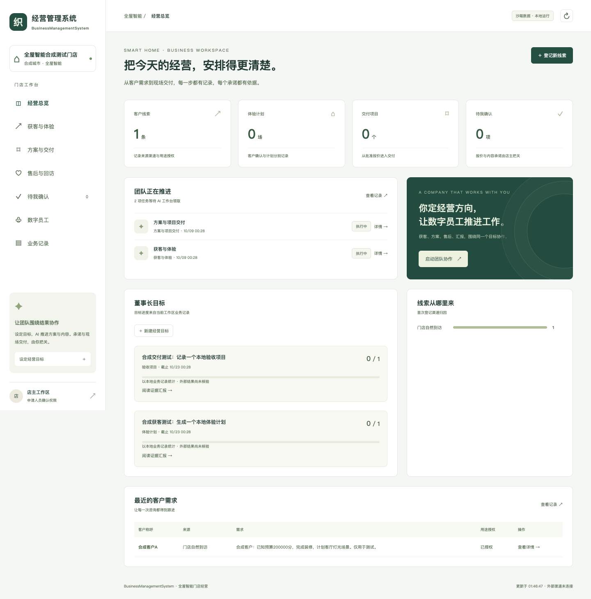

# business-management-system · 能力导览（人类版）

> 经营管理系统（BusinessManagementSystem）· 全屋智能门店获客、方案报价、项目交付与售后 · 宿主AI模型驱动
> 本文件由 `node scripts/generate-capabilities.mjs` 从代码事实**自动生成**（2026-10-08），
> 请勿手改——能力变更后重跑生成器即可。Agent 版机器清单见 docs/capability-map.md。
> 目录可发现、实际能调用、结果已验证是三个不同字段。缺少同提交运行证据时，调用与结果一律显示“未验证”；演示入口不代表客户业务可用。

## 🚀 5 分钟体验路径

```bash
node scripts/business-management.mjs setup --client all
node scripts/business-management.mjs init --demo
node scripts/business-management.mjs serve
```

| 端 | 地址 | 看什么 |
|---|---|---|
| 全屋智能工作台 · 桌面/手机 | http://127.0.0.1:9393 | 当前 SQLite 工作区经营状态、人工待办与 AI 任务 |
| AI 工作台接入 | docs/AI-WORKBENCH.md | Codex/千问办公/WorkBuddy 项目配置与执行协议 |

此路径使用明确标识的合成沙箱数据和当前宿主模型。后台调度不调用模型。下方继承平台目录使用独立 PostgreSQL 运行链，不能把存在的文件解释成全屋智能外部业务已经完成。



[390px 手机宽度截图](evidence/workbench-390.png)。实测和边界见 BUSINESS-MANAGEMENT-ACCEPTANCE.md。

## 📦 能力总览（40 项）

### 🏠 全屋智能门店经营（默认入口）

| 能力 | 一句话 | 怎么体验 | 可发现 | 可调用 | 结果已验证 / 环境 |
|---|---|---|---|---|---|
| **响应式经营工作台** | 目标、线索、体验、交付、售后、审批、岗位与业务记录；本机 SQLite 持久保存 | `pnpm dev` → http://127.0.0.1:9393 | 是 | 未验证 | 未验证 |
| **业务操作契约 ×39** | CLI/MCP/页面共用输入校验、租户范围、围栏、幂等与本地回执 | `pnpm bm catalog` / `pnpm bm:mcp` | 是 | 未验证 | 未验证 |
| **宿主模型工作流 ×5** | 当前工作台模型 claim→submit；调度器不调用模型；外部事实按证据保留待办 | docs/AI-WORKBENCH.md | 是 | 未验证 | 未验证 |
| **数字岗位 ×20** | 岗位拥有已安装技能，准备任务输出准确对象版本与 SOP 摘要 | bundles/smart-home/library/workforce.json | 是 | 未验证 | 未验证 |
| **行业技能 SOP ×35** | 固定流程执行本地业务对象；通用岗位任务输出分析/草稿/计划，人类与外部动作另行待办 | bundles/smart-home/skills/ | 是 | 未验证 | 未验证 |
| **克隆后工作台配置** | 生成当前项目 Codex/WorkBuddy 配置及千问办公导入 JSON；冲突保留，用户级配置不改 | `pnpm setup --client all` | 是 | 未验证 | 未验证 |

### 🖥 继承平台三端入口（独立运行链）

| 能力 | 一句话 | 怎么体验 | 可发现 | 可调用 | 结果已验证 / 环境 |
|---|---|---|---|---|---|
| **PC 端 · B 端工作台** | 经营主页/任务中心/规则中心/装配中心，目录描述不代表运行通过 | `pnpm preview:all` → http://localhost:3000 | 是 | 未验证 | 未验证 |
| **移动端 · B 端高保真** | 6 页演示资产；运行状态须验收 | `pnpm preview:all` → http://localhost:3001 | 是 | 未验证 | 未验证 |
| **移动端 · C 端 AI 服务前台** | 对话/服务/工单/消息入口；目录存在不代表已验证 | `pnpm preview:all` → http://localhost:3002 | 是 | 未验证 | 未验证 |

### 🏨 行业 Bundle（垂直能力包）

| 能力 | 一句话 | 怎么体验 | 可发现 | 可调用 | 结果已验证 / 环境 |
|---|---|---|---|---|---|
| **bundles/ai-pm/** | 围栏/技能/员工/对象/管线定义；装配结果需按环境验证 | 见 bundles/ai-pm/ 目录 | 是 | 未验证 | 未验证 |
| **bundles/hotel/** | 围栏/技能/员工/对象/管线定义；装配结果需按环境验证 | 见 bundles/hotel/ 目录 | 是 | 未验证 | 未验证 |
| **bundles/smart-home/** | 围栏/技能/员工/对象/管线定义；装配结果需按环境验证 | 见 bundles/smart-home/ 目录 | 是 | 未验证 | 未验证 |

### 🧑‍💼 继承平台的数字员工与数字人

| 能力 | 一句话 | 怎么体验 | 可发现 | 可调用 | 结果已验证 / 环境 |
|---|---|---|---|---|---|
| **数字员工中心（`/agents`）** | 继承平台的员工档案、围栏与任务入口；配置和运行状态须在目标工作区核实 | `pnpm preview:all` → http://localhost:3000/agents | 是 | 未验证 | 未验证 |
| **织伴数字人（Live2D 常驻浮层）** | 全页面常驻数字人：语音播报 + 口型/表情/动作 + 三态（小角落 / 大形象 / 屏保）+ 记忆透明面板 | 打开任一 PC 页面右下角；`pnpm preview:all` | 是 | 未验证 | 未验证 |
| **语音与口型引擎** | TTS 音色映射 + 中文逐字开口度时间线 + 音频振幅驱动口型；人设/音色可切换 | docs/voice-and-avatar-delivery-contract.md | 是 | 未验证 | 未验证 |
| **Live2D 渲染后端与资产** | pixi-live2d-display + Cubism core（MIT/官方 SDK）；换形象=换模型文件，驱动链路零改动 | apps/web/public/live2d/ | 是 | 未验证 | 未验证 |

### 🖐 操作电脑能力（本仓自带 · 可装生产工作站）

| 能力 | 一句话 | 怎么体验 | 可发现 | 可调用 | 结果已验证 / 环境 |
|---|---|---|---|---|---|
| **computer-use 三层感知入口** | 浏览器 DOM / GUI 语义树 / 像素兜底；安装、权限及运行结果须预检 | `pnpm computer:preflight && pnpm computer:smoke` | 是 | 未验证 | 未验证 |
| **HTTP 远程驱动 + MCP server** | 大脑/手分离：专用工作站被云端 Agent/CI 远程驱动（docs/computer-use-production.md） | `pnpm computer:serve` / `pnpm computer:mcp` | 是 | 未验证 | 未验证 |

### 🤖 继承平台引擎（目录发现，须独立验收）

| 能力 | 一句话 | 怎么体验 | 可发现 | 可调用 | 结果已验证 / 环境 |
|---|---|---|---|---|---|
| **围栏 DSL 引擎** | 事前裁决：支持 in/contains_any 列表语义 | 见 docs/capability-map.md L3 | 是 | 未验证 | 未验证 |
| **技能保鲜环（下行分发）** | 官方技能一键投放：五道预检 + L0/L1 静默/L2 审批 + 一键回滚 + 全事件留痕 | 见 docs/capability-map.md L3 | 是 | 未验证 | 未验证 |
| **L2 编排（ASK/QUEST）** | 一句话目标自动拆解多步骤并派发 | 见 docs/capability-map.md L3 | 是 | 未验证 | 未验证 |
| **夜班自动运行** | 离线任务推进，次日晨报 | 见 docs/capability-map.md L3 | 是 | 未验证 | 未验证 |
| **模型路由** | 离线确定性模型，无密钥可跑 | 见 docs/capability-map.md L3 | 是 | 未验证 | 未验证 |
| **五元事件 + RLS 隔离** | 全链路可追溯、可验链 | 见 docs/capability-map.md L3 | 是 | 未验证 | 未验证 |
| **IM 渠道** | 企微等出入站，审批卡片直达手机 | 见 docs/capability-map.md L3 | 是 | 未验证 | 未验证 |
| **C 端 AI 服务前台** | 对话/已装配行业知识库/工单/SLA；行业适配器限定公开查询范围 | 见 docs/capability-map.md L3 | 是 | 未验证 | 未验证 |
| **自动巡检** | 异常发现→派发→处置闭环 | 见 docs/capability-map.md L3 | 是 | 未验证 | 未验证 |
| **人审台** | 必审事项人拍板，AI 不越权 | 见 docs/capability-map.md L3 | 是 | 未验证 | 未验证 |

### ✅ 验证与质量（工程纪律）

| 能力 | 一句话 | 怎么体验 | 可发现 | 可调用 | 结果已验证 / 环境 |
|---|---|---|---|---|---|
| **项目配置初始化** | 本机工作台项目配置；平台安装另用 setup:foundation | `pnpm setup` | 是 | 未验证 | 未验证 |
| **全屋智能业务回归** | 正常/边界/错误/权限/并发/摘要/租约/回执回归；实际结果见本次报告 | `pnpm test:business` | 是 | 未验证 | 未验证 |
| **主测试套件** | 数百条场景用例逐条执行 | `pnpm suite` | 是 | 未验证 | 未验证 |
| **发布门禁** | 未全过禁止发布（硬性） | `pnpm release:gate` | 是 | 未验证 | 未验证 |
| **五元事件验链** | 事件链完整性校验 | `pnpm db:verify-chain` | 是 | 未验证 | 未验证 |
| **Agent 能力巡游** | 遍历登记能力的检查入口；覆盖与结果看本轮报告 | `pnpm agent:tour` | 是 | 未验证 | 未验证 |
| **环境自检** | 一屏排查环境问题 | `pnpm doctor` | 是 | 未验证 | 未验证 |

### 🎁 演示与交付资产

| 能力 | 一句话 | 怎么体验 | 可发现 | 可调用 | 结果已验证 / 环境 |
|---|---|---|---|---|---|
| **高保真演示页 ×6** | 糖果色，含手机壳容器 | http://localhost:3001 | 是 | 未验证 | 未验证 |
| **官网静态站** | 对外产品故事 | apps/site/index.html | 是 | 未验证 | 未验证 |
| **自带技能 ×5** | client-demo-recorder / component-integration / industry-entry / product-feedback 等 | skills/official/ | 是 | 未验证 | 未验证 |
| **能力导览 PPT** | 路演/汇报直接用 | docs/capability-tour.pptx | 是 | 未验证 | 未验证 |
| **Mock 数据体系** | 种子 + 离线模型 + 演示直登；显式模拟环境 | mock/README.md | 是 | 未验证 | 未验证 |

## 🧭 下一步

- 想二次开发：读 AGENTS.md → 跑 `pnpm agent:tour` → 看 docs/capability-map.md（全量机器清单）
- 想改 UI：先读当前入口的视觉与交互实现，改完在桌面/手机宽度运行并截图核对
- 想发布：`pnpm release:gate` 全过是硬性门禁，清单见 docs/release-checklist.md
